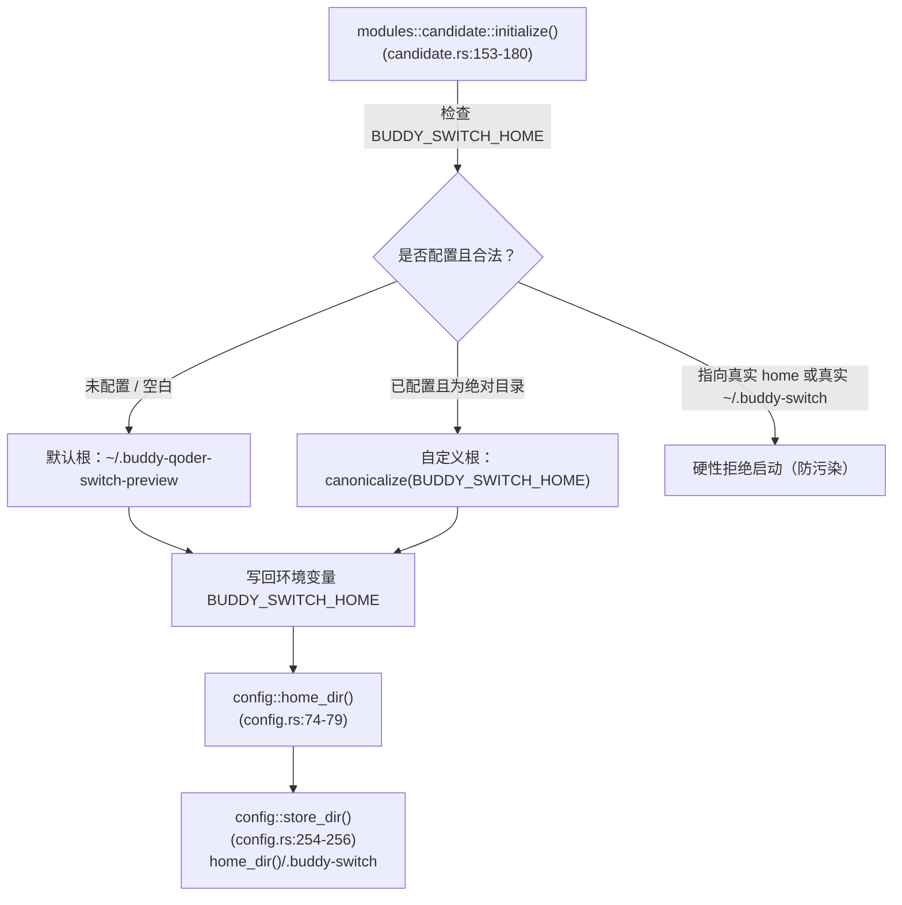

# BuddySwitch 整合预览版最终写入路径全景台账

> 状态：已冻结（只读基线）  
> 归档日期：2026-10-22  
> 适用版本：BuddySwitch Fusion Preview（整合预览版）  
> 审查基线代码库：`D:\Project\buddy-Qoder-Switch\app`  

---

## 1. 概述与隔离设计原理

整合预览版为了在同一台机器上与既有的 BuddySwitch 正式版（以及外部 Qoder / WorkBuddy 客户端）并行运行，设计了双层路径体系：
1. **应用自身数据完全隔离**：本应用的账号、密钥、配置、用量统计及桌面鉴权模拟文件全部收敛于独立的**预览数据根**下，严禁污染或继承现存正式版数据。
2. **外部客户端数据受控交互**：对于运行在主机真实主目录下的外部客户端（WorkBuddy、Qoder），系统通过**目录联接（Directory Junction / Symlink）**或环境变量控制进行受控读写。若未显式开启联接，则对外部客户端目录完全零改动。

本文档完整枚举整合预览版在全生命周期内的所有最终写盘路径、触发机制、代码位置及外部穿透性。

---

## 2. 数据根解析链（Data Root Resolution Chain）

整合预览版启动时，首要任务是确定本次进程的唯一数据落地点。解析链分为三级：



### 2.1 详细步骤与代码位置

1. **入口重定向校验**：`crates/buddy-switch-core/src/modules/candidate.rs:153-180`
   - **默认位置**：未配置 `BUDDY_SWITCH_HOME` 时，默认使用 `dirs::home_dir().join(".buddy-qoder-switch-preview")`。
   - **安全红线**：若配置了 `BUDDY_SWITCH_HOME`，必须为已存在的绝对目录；且**严禁等于真实 `real_home` 或真实 `real_home/.buddy-switch`**（`allowed_root` 检查，`:108-110`）。一旦触犯红线，进程直接返回 `Err` 拒绝启动。
   - **环境变量回写**：解析并规范化（`canonicalize`）后，通过 `std::env::set_var(BUDDY_SWITCH_HOME_ENV, &canonical)` 回写环境变量，确保后续全部子模块统一生效。
2. **中间家目录覆盖**：`crates/buddy-switch-core/src/modules/config.rs:74-79` 与 `:164-183`
   - `config::home_dir()` 优先调用 `home_dir_override()` 读取已生效的 `BUDDY_SWITCH_HOME` 环境变量。
   - 此时 `config::home_dir()` 的返回值被成功重定向至 `~/.buddy-qoder-switch-preview`。
3. **数据存储根派生**：`crates/buddy-switch-core/src/modules/config.rs:254-256`
   - `config::store_dir()` 统一返回 `home_dir().join(".buddy-switch")`。
   - **默认最终数据存储根**：`~/.buddy-qoder-switch-preview/.buddy-switch/`。

---

## 3. 外部客户端目录联接机制（Directory Junction）

外部客户端（Qoder CLI / WorkBuddy）本身是独立安装在系统真实用户主目录下的应用（如 `~/.qoder-cn`、`~/.workbuddy`）。
为了让整合预览版既能访问客户端会话/登录态，又不打破预览家目录边界，设计了目录联接机制。

### 3.1 联接清单与实现规则

- **联接目标清单**：`candidate.rs:23`
  ```rust
  const CLIENT_LINK_DIRS: &[&str] = &[".qoder-cn", ".qoder", ".workbuddy", ".workbuddy-ai"];
  ```
- **联接执行条件**：`candidate.rs:136-150`（`link_external_client_dirs`）
  - 预览侧若同名路径已存在（包括悬挂联接或已存在的目录），**一律跳过，绝不覆盖**；
  - 真实用户目录下对应客户端目录不存在（用户未安装/未使用），**直接跳过，不凭空创建伪目录**；
  - 单个联接失败不阻断进程启动。
- **底层系统调用**：`candidate.rs:112-124`
  - Windows 环境下优先通过 `cmd /C mklink /J <link> <target>` 创建免提权目录联接（Junction）；
  - 若 `mklink /J` 失败，降级回退至 `std::os::windows::fs::symlink_dir`。
  - Unix 环境直接使用 `symlink`。
- **触发时机**：应用启动阶段。桌面端 `src-tauri/src/main.rs:5` 与独立服务端 `crates/buddy-switch-server/src/main.rs:439` 在初始化 runtime 之前首先执行 `candidate::initialize()`。

### 3.2 显式开关控制现状

- **控制开关**：`BUDDY_SWITCH_PREVIEW_LINK_CLIENT_DIRS`（`candidate.rs:20`）。
- **解析语义**：`candidate.rs:45-68`
  - 未设置、空白、或设为 `"0"` / `"false"` / `"off"` / `"no"` 时判定为 `Off`；
  - 设为 `"1"` / `"true"` / `"on"` / `"yes"` 时判定为 `On`；
  - **默认状态**：**关（Disabled）**。
- **演进事实说明**：
  - PRD §13.2 早期调研时曾指出该环境变量在代码中未被实现（联接曾为启动时无条件行为）。
  - **当前工作树已完全实现该开关**（`candidate.rs:91-99` `preview_client_dirs_link_enabled`），并且前端通过 `preview-link-banner.tsx` 与 `/api/status` 暴露联接开关状态。在未显式设置 `BUDDY_SWITCH_PREVIEW_LINK_CLIENT_DIRS=1` 的情况下，启动**绝不创建任何外部客户端目录联接**。

---

## 4. 穿透联接直达真实客户端目录的写点（Piercing Write Points）

在 `BUDDY_SWITCH_PREVIEW_LINK_CLIENT_DIRS=1` 开启或客户端目录被有效联接时，以下操作将穿透联接点，**最终写入宿主机真实用户主目录或应用漫游数据**：

### 4.1 Qoder CLI 凭据写回

- **路径模板**：
  - CN 区：`~/.buddy-qoder-switch-preview/.qoder-cn/.auth/user`
    $\rightarrow$ 经 Junction 直达：`~/.qoder-cn/.auth/user`
  - Global 区：`~/.buddy-qoder-switch-preview/.qoder/.auth/user`
    $\rightarrow$ 经 Junction 直达：`~/.qoder/.auth/user`
- **代码位置**：
  - 路径生成：`crates/buddy-switch-core/src/modules/qoder/paths.rs:123-125`（`cli_home_dir`）及 `:131-133`（`cli_auth_file`）
  - 写入逻辑：`crates/buddy-switch-core/src/modules/qoder/switch.rs:646-653`（`write_bytes` 调用 `atomic_write_bytes`）；行 `693`（切换回滚写）
- **触发条件**：
  - 用户在 UI 上触发 Qoder 账号切换或 CLI 登录态写回；
  - 登录态切换失败时的异常安全回滚。
- **是否经联接直达真实客户端**：**是**（当开启联接时，经 `.qoder-cn` / `.qoder` Junction 直达）。

### 4.2 Qoder 桌面版凭据写入（特例：不经联接，直达 Roaming）

- **路径模板**：
  - CN 区：`%APPDATA%\com.qodercn.app.stable\auth.v1.dat`
  - Global 区：`%APPDATA%\com.qoder.app.stable\auth.v1.dat`（依据 `qoder/region.rs:124` 与 `:141` 的 realm 表）
- **代码位置**：
  - 路径生成：`crates/buddy-switch-core/src/modules/qoder/paths.rs:113-120`（`roaming_dir`）与 `:146-148`（`desktop_auth_file`）
  - 写入逻辑：`crates/buddy-switch-core/src/modules/qoder/switch.rs:303`, `:333`, `:472`
- **穿透机理分析**：
  - `paths::roaming_dir()` 优先直接读取系统环境变量 `APPDATA`。在 Windows 操作系统中，`APPDATA` 指向全局漫游主目录（`C:\Users\<User>\AppData\Roaming`），并不位于 `home_dir()` 之下。
  - **结论**：**桌面版 Qoder 凭据写回完全绕过预览家目录与 Junction 机制，属于无条件直达宿主机真实桌面客户端目录的写操作**。

### 4.3 WorkBuddy 会话复制、切换与同步写操作

- **基础路径**：
  - CN 区：`~/.buddy-qoder-switch-preview/.workbuddy/` $\rightarrow$ Junction 直达 `~/.workbuddy/`
  - Global 区：`~/.buddy-qoder-switch-preview/.workbuddy-ai/` $\rightarrow$ Junction 直达 `~/.workbuddy-ai/`
- **路径派生代码**：`crates/buddy-switch-core/src/modules/session.rs:57-63`（`session_data_dir`）
- **细分写点与触发条件**：
  1. **会话 JSONL 数据同步**：
     - 路径：`<session_data_dir>/resources/sessions/<session_id>.jsonl`
     - 代码：`session.rs:2226-2238`（`copy_jsonl_for_plan` 内 `std::fs::write`）
     - 触发：跨账号或跨区域克隆/复制会话方案。
  2. **会话副本统一与覆写**：
     - 路径：`<session_data_dir>/resources/sessions/<session_id>.jsonl`
     - 代码：`session.rs:1353-1411`（`unify_replica_between_files`，先备份为 `.jsonl.bak` 再覆盖）
     - 触发：会话副本双向同步与修复。
  3. **WorkBuddy 数据库备份与索引写入**：
     - 路径：`<session_data_dir>/workbuddy.db` 与 `<session_data_dir>/backups/workbuddy.db.<timestamp>.bak`
     - 代码：`session.rs:1759-1785`（`backup_db_to`）
     - 触发：账号切换或会话写入前对客户端 SQLite 库的安全备份。
  4. **复制台账（Copy Ledger）**：
     - 路径：`<session_data_dir>/buddy-switch-copy-ledger.json`
     - 代码：`session.rs:2649-2651`（`copy_ledger_path_for`）与 `:2727`
     - 触发：会话迁移记录落盘。
  5. **基线记录（Session Baselines）**：
     - 路径：`<session_data_dir>/buddy-switch-session-baselines.json`
     - 代码：`session.rs:2693-2695`（`session_baseline_path_for`）与 `:2824`
     - 触发：生成或更新会话校验基线。
- **是否经联接直达真实客户端**：**全部直达**（全部建立在 `session_data_dir` 之上，直接作用于外部客户端会话库）。

### 4.4 Qoder CLI 模型缓存目录查证（零写点）

- **路径定义**：`crates/buddy-switch-core/src/modules/qoder/paths.rs:136-138`
  ```rust
  pub fn cli_models_cache_dir(region: QoderRegion, uid: &str) -> PathBuf {
      cli_home_dir(region).join(".models").join(uid)
  }
  ```
- **实际使用查验**：
  - 经全仓文本与调用链检索，`cli_models_cache_dir` 仅存在定义与单元测试（`:241`）。
  - 网关模块明确记录弃用说明（`crates/buddy-switch-gateway/src/qoder/mod.rs:322-325`）：
    > "那只是路径助手（全仓零读取点，见 grep），用它会要求本仓自造一个 CLI 清单文件的解析格式 —— 我们不知道官方 CLI 落盘的字段，硬猜等于编数据。故不用。"
  - **结论**：**当前全仓对 `cli_models_cache_dir` 保持零读取、零写入调用**，不构成实际落盘写点。

---

## 5. 应用自身数据写点（完全隔离于预览根目录）

以下所有文件均落在预览根目录（`~/.buddy-qoder-switch-preview/`）及其专有存储子目录（`.buddy-switch/`）之下。
**这些路径绝不包含在 `CLIENT_LINK_DIRS` 之中，与宿主机正式版及真实客户端完全物理隔离**：

| 文件类别 | 最终绝对落盘路径模板 | 触发条件 | 代码位置（文件:行号） | 是否触碰真实客户端 |
| :--- | :--- | :--- | :--- | :---: |
| **WB 账号库** | `~/.buddy-qoder-switch-preview/.buddy-switch/accounts.json`（CN）<br/>`~/.buddy-qoder-switch-preview/.buddy-switch/accounts.global.json`（Global） | 导入/切换/删除账号、刷新凭据 | `region.rs:244-246`<br/>`account.rs:30` (`atomic_write`) | **否**（隔离） |
| **WB 回收站** | `~/.buddy-qoder-switch-preview/.buddy-switch/accounts.trash.json`（CN）<br/>`~/.buddy-qoder-switch-preview/.buddy-switch/accounts.trash.global.json`（Global） | 账号软删除 | `region.rs:252-254`<br/>`account.rs:2046` | **否**（隔离） |
| **WB 模拟登录态** | `~/.buddy-qoder-switch-preview/workbuddy-desktop.info`（CN）<br/>`~/.buddy-qoder-switch-preview/workbuddy-desktop-ai.info`（Global） | 切换当前激活账号，向本应用供凭据 | `region.rs:178/:196`<br/>`auth_file.rs:357` (`atomic_write`) | **否**（位于 preview home 根，非 .workbuddy） |
| **网关配置与 Key** | `~/.buddy-qoder-switch-preview/.buddy-switch/gateway_config.json`<br/>`~/.buddy-qoder-switch-preview/.buddy-switch/gateway_keys.json` | 启动网关服务、新建/撤销 API Key | `region.rs:257-264` | **否**（隔离） |
| **模型目录缓存** | `~/.buddy-qoder-switch-preview/.buddy-switch/gateway_models.cn.json`<br/>`~/.buddy-qoder-switch-preview/.buddy-switch/gateway_models.global.json` | 成功拉取两区模型清单后落盘缓存 | `region.rs:267-269`<br/>`catalog.rs:856` | **否**（隔离） |
| **官方用量缓存** | `~/.buddy-qoder-switch-preview/.buddy-switch/official_usage_cache.json`（CN）<br/>`~/.buddy-qoder-switch-preview/.buddy-switch/official_usage_cache.global.json`（Global） | 积分用量页点击刷新官方用量 | `region.rs:283-288`<br/>`official_usage.rs:240` | **否**（隔离） |
| **Token 统计日台账**| `~/.buddy-qoder-switch-preview/.buddy-switch/token_daily.json`（CN）<br/>`~/.buddy-qoder-switch-preview/.buddy-switch/token_daily.global.json`（Global） | 网关请求流处理结束、记录当日 token | `region.rs:298-303`<br/>`token_daily.rs:238` | **否**（隔离） |
| **积分用量快照** | `~/.buddy-qoder-switch-preview/.buddy-switch/credit_usage_snapshots.json` | 定时积分采集任务成功 | `credit_usage.rs:15`, `:183` | **否**（隔离） |
| **可执行路径缓存** | `~/.buddy-qoder-switch-preview/.buddy-switch/workbuddy_exe.json` | 自动扫描或用户手动指定客户端可执行文件路径 | `config.rs:501`, `:537` | **否**（隔离） |
| **Qoder 专有数据目录** | `~/.buddy-qoder-switch-preview/.buddy-switch/qoder/` 目录下全部文件：<br/>- `accounts.cn.json` / `accounts.global.json`<br/>- `accounts.trash.cn.json` / `accounts.trash.global.json`<br/>- `account_cooldowns.cn.json` / `account_cooldowns.global.json`<br/>- `checkin_ledger.cn.json` / `checkin_ledger.global.json`<br/>- `credits_daily.cn.json` / `credits_daily.global.json`<br/>- `settings.json`<br/>- `gateway_config.json`<br/>- `gateway_keys.json`<br/>- `logs/*.log` | Qoder 模块管理、签到冷却记账、每日积分抓取、日志回滚 | `crates/buddy-switch-core/src/modules/qoder/paths.rs:37-98`<br/>`qoder/store.rs` | **否**（全收敛于 preview `qoder/` 独立目录，完全隔离） |
| **本应用数据自动备份** | `~/.buddy-qoder-switch-preview/.buddy-switch/backups/*.zip` 或 `*.json` | 导入/迁移前自动触发数据快照 | `backup.rs:751`<br/>`backup_sections.rs:376` | **否**（隔离） |

---

## 6. 最终写盘风险与防御审查结论

1. **宿主机零修改默认态**：在默认启动且未指定 `BUDDY_SWITCH_PREVIEW_LINK_CLIENT_DIRS=1` 时，Junction 联接机制完全不激活。除了 Qoder 桌面版特定写回（`APPDATA` 漫游文件）外，**外部客户端主目录下的 `.qoder-cn`、`.qoder`、`.workbuddy`、`.workbuddy-ai` 保持绝对只读与零侵入**。
2. **两区隔离性保障**：两区（CN 与 Global）的凭据（`.info`）、账号库（`accounts*.json`）、用量缓存（`official_usage_cache*.json`）及每日 token（`token_daily*.json`）在文件名级别全面实现双轨隔离，杜绝交叉覆盖。
3. **原子性写盘防护**：全仓写操作均通过统一的基础设施函数 `config::atomic_write` / `config::atomic_write_bytes`（临时文件写入 + 校验 + 原子 rename）进行，即使断电或进程中断，亦不会产生半死半活的畸形配置文件。
