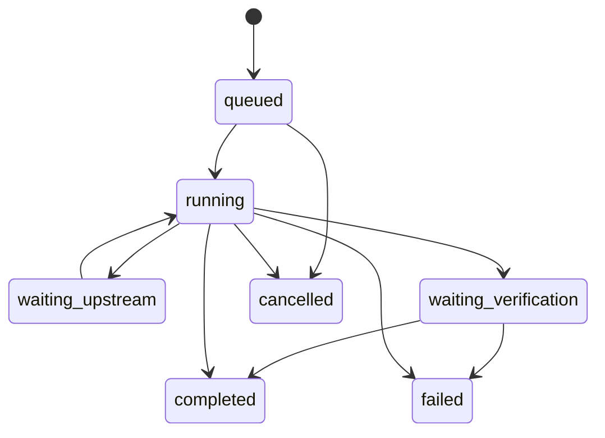
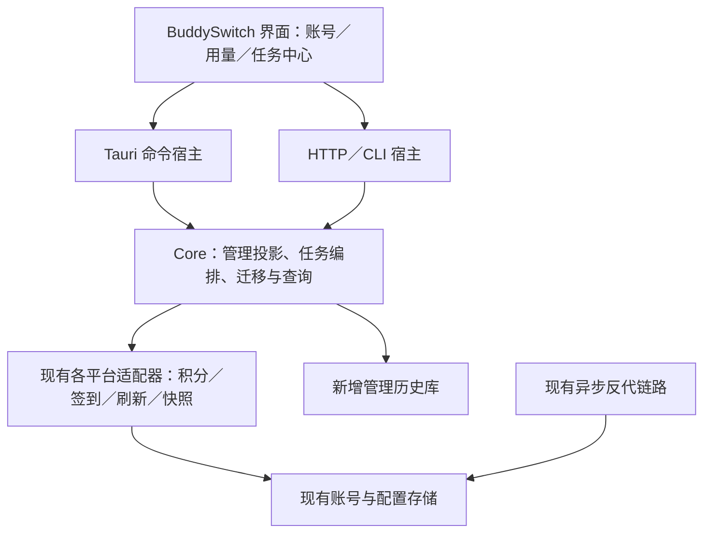

# BuddySwitch × TraeWorkAssistant 产品整合 PRD 与实施计划

> 状态：实施中（2026-10-23 已补 W06 应用内排程接线、时点去重和租约过期后的中断记录恢复，离线验证通过；见 [当前交付与隔离更正](../evidence/2026-10-23-fus-runtime-and-isolation.md)。此前测试隔离声明存在错误，真实用户管理库已被写入测试记录，快照保留且尚未清理，详见同页 §1。真实平台动作、只读到账复查、完整事件补读与 W07 等仍未交付，不能将整合或 W06 认定为完整闭环）。既有记录保留在 [2026-10-22 证据](../evidence/2026-10-22-fus-core-management.md) 与 [执行器修正记录](../evidence/2026-10-23-fus-task-engine-review.md)。
> 权威参考：以 `D:/desktop/FUSION-INTEGRATION-v1.1.md` 为权威实施基准。
> 产品方向：以 BuddySwitch 为主程序，将 TraeWorkAssistant 的非反代管理能力迁入现有产品，交付可使用的界面、数据、后台执行与恢复机制。
> 优先顺序：先处理并验证 Qoder DeepSeek 的工具调用、连接及提前结束，再验证 Qoder Global 签到；可以同步进行不访问真实账号的原型、数据设计与离线开发。

## 1. 要交付什么

交付一个 BuddySwitch：继续使用它的账号体系、区域隔离、异步网关和桌面/服务端分层，同时具备 TraeWorkAssistant 中可迁移的积分、签到、成长任务、分组标签、凭据管理、备份与平台管理能力。

迁移包括功能实际依赖的业务规则、数据采集、持久化、后台任务、页面与异常处理。不是只更换皮肤，也不是在 BuddySwitch 里嵌入另一套独立应用。

用户最终应能完成以下流程：

1. 选择平台与区域，看到所属账号、积分余额、积分来源与数据更新时间。
2. 打开用量页，查看积分收支、积分包与到期日历；能区分官方账单、本地快照与估算。
3. 打开任务中心，手动或定时执行签到、奖励领取、成长任务、续期与数据同步，查看逐账号进度。
4. 离开任务页面再回来，进度和结果仍然存在；程序重启后能看到上次执行状态。
5. 遇到失败，知道是排队、凭据失效、活动未开放、网络故障还是结果待确认，并有对应处理入口。
6. 用分组与多个标签管理账号，备份并恢复数据，查看凭据状态，必要时明确重新登录。
7. 后续扩展豆包的非反代功能，沿用同一套管理规则。

## 2. 已确认方向、建议方案与验收状态

| 类别 | 内容 |
| --- | --- |
| 用户已明确的方向 | 将 TraeWorkAssistant 的非反代能力迁入 BuddySwitch；需要完整管理功能；先解决工具与连接问题，再处理 Global 签到 |
| 本 PRD 建议采用 | 复用现有账号与适配器；新增任务中心；在现有用量入口补齐积分视图；新增长期历史存储；分批交付 |
| 尚未执行 | 本 PRD 中的新页面、任务数据模型、共享标签、长期历史库、保险库迁移、豆包接入 |
| 仍待真实验收 | 当前 Qoder Global 提前结束的根因与修复效果；CN 实际生成吞吐；Global 奖励领取及到账链路 |

本次只编写 PRD 与文档索引，不改业务代码、运行实例、真实账号、定时任务或客户端会话。后续开工应以本 PRD 的需求编号建立执行清单，完成一项记录一项，不将整份计划整体标成“已实现”。

## 3. 事实基线与证据边界

### 3.1 源码基线

| 对象 | 本次检查的基线 | 用途 |
| --- | --- | --- |
| TraeWorkAssistant | 工作区 `upstream/TraeWorkAssistant/`，v3.8.0，`e44abbcf42038e9105111011ade689477ec8652f` | 功能与实现参考快照，不声称是远端最新版 |
| BuddySwitch 原始基座 | `cbd2bf9380a90a8743c5de00bc7437c593961e76` | 追溯原始架构 |
| 迁移目标 | 当前 `app/` 工作树 | 已含多轮未提交整合修改，不能仅用 HEAD 代表实际候选版本 |
| 上轮候选包 | `../../../reports/qoder-reasoning-package.json` | 哈希、离线测试、未完成的真实验收；不是本 PRD 的完成证明 |

开工时重新记录：源仓提交、目标 HEAD、目标工作树补丁哈希、新增文件清单、候选 EXE 哈希、数据目录及当前配置快照。旧报告只作为取证线索，不继承其“通过”结论。

### 3.2 当前已经具有的能力

BuddySwitch 已有 WorkBuddy、Trae、Qoder 的账号/区域管理，以及不同程度的积分、签到、续期、用量图表、快照、备份和会话管理。本次是逐项合并与补齐；已有模块先复用，不创建第二份权威账号库或第二套同类执行器。

近期证据必须单列：

- `../../../reports/zcode-qoder-20261022-blank-stop-evidence.json`：Global 曾以 `end_turn`、573 正文字符、0 工具调用结束；CN 曾继续执行工具。只有客户端记录，不能反推对应原始上游流一定完整。
- `../../../reports/QODER-RAW-DIAGNOSIS-20261022.md`：两区独立原始流探针均收到 HTTP 200 内嵌业务 429，无有效生成输出。上游持续排队，尚无本次可用的实际吞吐测量。
- 网关显式推理档位透传有本地修复及回归；不代表它是提前结束根因，也不代表已经提速。
- TraeWorkAssistant 的 Qoder Global 支持仍有待实施文档。国内区签到、积分端点和活动规则不能直接外推到国际区。

### 3.3 本文与既有规格的关系

本 PRD 管“迁哪些功能、用户如何使用、实施依赖与如何验收”。沿用 [词汇表](VOCABULARY.md)、[总方案](PLAN.md)、[后端分层](P5-ARCH.md)、[用量规格](P3-ARCH.md)、[备份规格](P7-ARCH.md)、[Qoder 规格](QODER-PLATFORM.md)。旧期次编号和全局决策号不复用；本轮需求统一用 `FUS-Rxx`，实施包用 `FUS-Wxx`。

文末附录保留本轮之前的整合规格原文。其中具体日期、参数和验收描述是既有记录；当前实施状态以本 PRD §2、§3 和后续逐项证据为准。落地行为变化时再同步相关现行规格，不静默改写旧报告。

## 4. 范围与分批交付

### 4.1 完整需求清单

“已有基础”仅表示源码存在对应能力，不表示本轮验收通过。下表不是将已有能力重新全部开发一次。

| ID | 功能与交付内容 | 当前基础/增量 | 首次交付 |
| --- | --- | --- | --- |
| FUS-R01 | Qoder 连接、队列、原始结束帧与工具循环诊断，明确提前结束根因 | 有前期修复与诊断，真实问题未闭环 | 稳定性前置 |
| FUS-R02 | 统一积分工作台：余额、收支、积分包、到期、来源说明 | 复用现有用量页，补齐平台差异 | 核心版 |
| FUS-R03 | 套餐/附加/专属积分分类，逐包明细与到期日历 | 已有部分余额、资源包与到期分布；补字段与日历 | 核心版 |
| FUS-R04 | 长期余额快照、入账与消耗趋势、按账号/分组筛选 | 已有部分采集；补统一历史与可比性规则 | 核心版 |
| FUS-R05 | Trae 官方消费账单、WorkBuddy 官方用量对账 | WorkBuddy 已有，Trae 补官方明细采集 | 核心版 |
| FUS-R06 | 模型排行、Token/缓存统计、会话消费明细 | 保留现有图表与会话能力，补数据适配与来源标记 | 核心版 |
| FUS-R07 | 统一签到与奖励工作台，单号/勾选/分组执行及实时进度 | 复用现有操作，新增统一页面与任务记录 | 核心版 |
| FUS-R08 | 签到月历、每日逐账号结果、失败筛选与复查 | 有记录基础，补月历及查询 | 核心版 |
| FUS-R09 | Qoder 活动卡片、开放窗口、签到/登录奖励及到账状态 | 已有活动框架；Global 先单独核实再接线 | 核心版，受前置约束 |
| FUS-R10 | WorkBuddy 成长中心：旅行、盲盒、已完成任务领奖 | 已有旅行/活动，逐项比对并补统一编排与结果 | 核心版 |
| FUS-R11 | WorkBuddy Global 活跃奖励的任务完成/奖励到账分离 | 复用实验适配器，保留待确认，单独真实验收 | 核心版，受上游条件约束 |
| FUS-R12 | 自动任务面板：频率、时点、最近/下次执行、失败原因 | 复用调度器，扩展任务元数据与界面 | 核心版 |
| FUS-R13 | 启动补跑、互斥、间隔、退避、重复触发去重、恢复 | 已有部分机制，统一行为并验证 | 核心版 |
| FUS-R14 | 跨平台共享分组与多标签，按作用域管理绑定 | 已有部分分组，补共享定义、多对多标签 | 管理增强版 |
| FUS-R15 | 凭据生命周期：来源、到期、最近保存、刷新失败、重登入口 | 已有刷新与状态判断，补统一投影 | 管理增强版 |
| FUS-R16 | OAuth/PAT/本机扫描入口与失败处理一致化 | 复用已有登录与发现能力，补实际差项 | 管理增强版 |
| FUS-R17 | 登录态快照、版本校验、恢复前保护与回滚 | 保留现有快照与切换，核对并补保护措施 | 管理增强版 |
| FUS-R18 | 会话备份、恢复、复制与导出体验补齐 | 保留 BuddySwitch 现有高级会话能力 | 管理增强版 |
| FUS-R19 | TraeWorkAssistant 数据导入预览、冲突处理、凭据可选与恢复 | 在现有备份/导入机制上加源格式适配器 | 管理增强版 |
| FUS-R20 | 应用自有凭据保险库，完整迁移/恢复/重新登录路径 | 单独设计；原生客户端凭据解密不等于应用保险库 | 安全存储批次 |
| FUS-R21 | 豆包账号、额度、保活、快照、对话备份与导出 | 新增平台；不引入豆包公开 API 反代 | 平台扩展版 |
| FUS-R22 | 环境检查、按项登出/重置与可恢复的执行清单 | 对比已有诊断/设备隔离，按程序位补缺项 | 平台扩展版 |
| FUS-R23 | 通知、执行记录、切页保留进度、主题/引导一致性 | 复用现有 UI 与日志体系，补管理任务体验 | 各批次共同交付 |

核心版不宣称完整迁移结束。完整整合的完成条件是上述 23 项都有明确去向：复用并通过、补齐并通过，或经明确范围变更后延期。服务端没有活动、接口暂不可用与功能尚未实现分别记录，不能合并成“已支持”。

### 4.2 本计划不搬入的内容

- TraeWorkAssistant 的 API 网关、同步流运行时、模型池调度、流式转换、竞速对冲等反代实现。
- 其完整 Tauri `AppState`、整套 store、主程序启动流程、安装器与旧应用自动卸载逻辑。
- 为账号接入自动开启的 MITM、系统代理接管、CA 安装；新增平台先走可用的授权/本机只读发现途径。
- 把原项目的 SQLite、Stronghold 和所有历史文件直接覆盖到 BuddySwitch 数据目录。
- 将旧活动 ID、固定奖励数额、特定端点的历史可用性作为永久事实。

## 5. 产品页面与交互

### 5.1 信息架构

保留现有目的地与能力门控，补一个“任务中心”，不复制一套 TraeWorkAssistant 侧栏。下表是目标结构；具体路由/命令名为设计建议，开工时与现行注册表一并冻结。

| 入口 | 内容与默认行为 |
| --- | --- |
| 概览 | 当前作用域的积分摘要、临期积分、待确认奖励、运行任务与数据更新时间；摘要可点击进入明细 |
| 账号 | 现有卡片/表格/详情抽屉；补标签、凭据状态、最近签到/任务状态；保留现有切换入口 |
| 用量 | 保留趋势/模型/会话/积分视图；积分视图补“积分包”“到期日历”；无相应数据源的视图显示原因 |
| 任务中心（新增） | 默认“签到与奖励”，另有“自动任务”“执行记录”；既能手动执行，也能查看后台任务 |
| 会话 | 保留现有会话工作台、备份与迁移入口，按程序位能力展示 |
| 设置 | 统一数据同步、通知、备份、凭据存储、平台路径等设置；避免多个页面保存互相覆盖 |

平台与区域继续决定数据作用域。时间范围、来源、视图、合并展示只决定怎么看。示例：`/s/qoder-global/tasks?view=rewards`；此例是新增路由建议，不代表当前已有路由。

跨作用域汇总为只读统计；领取、刷新凭据、切换客户端等写操作必须保留每个账号的原作用域。不同区域相同 uid 不自动当成同一账号。

### 5.2 积分工作台

默认显示可用余额、区间确认入账、区间消耗、即将到期四个摘要。下方为收支趋势、余额变化、积分包表及到期日历。共享筛选包括时间、账号、分组、标签与数据来源。

积分包至少展示：账号、类型、来源、可用余额、总额、到期时间、最近观测时间、是否使用缓存。字段未知显示“未提供”，不得用 0 或“永久有效”代替。

点击日历日期只筛选当日到期包，不触发网络刷新或领取。未来到期日历由有效积分包生成；签到月历由任务/领取记录生成，两张日历不能共用一份含糊数据。

错误或接口不可用时：保留上次成功数据并标“缓存/更新失败”，展示错误与重试入口；首次无数据明确显示“尚未取到”。手动刷新期间保留当前筛选，阻止重复提交。

### 5.3 签到与奖励

页面显示当前区域活动列表、开放窗口与可领账号；奖励数额以活动响应为准。手动触发前可选勾选账号、分组、跳过已确认领取、账号间隔。

执行时显示逐账号阶段和汇总：待执行、运行中、等待上游、待确认、已到账、此前已领、失败、不适用/跳过。界面可离开，后台继续；返回后恢复同一个 run，不重新提交。

“停止”取消尚未开始的账号与后续步骤；已发到上游的写请求不能声称已撤销。该账号进入待确认，后续只复查状态。批量“重试失败”不包含待确认项、已领项和不适用项。

概览与账号菜单中的“签到”进入同一执行器，不能新增另一条绕过互斥或记录的快捷路径。

### 5.4 自动任务与执行记录

每项任务显示平台、区域、账号范围、启用状态、频率、执行窗口、最近结果、下次计划及失败原因。范围变更后需明确是固定账号集合还是执行时动态读取分组，默认固定账号集合，保存时展示实际账号数量。

任务详情包括逐账号记录、阶段、开始/结束时间、重试次数、下一次可重试时间和结果依据。桌面通知链接回该记录；通知数量做合并，不能每一次内部轮换都弹通知。

目标通用频率为每日指定时点、每隔 N 小时、每隔 N 天；平台限制或领取窗口覆盖通用频率。无实际时间依据时“预计等待”留空，不用循环倒计时伪装上游进展。

## 6. 管理数据的统一口径

### 6.1 数据源分开存，按规则投影

| 数据源 | 可以表达什么 | 不可以推导什么 |
| --- | --- | --- |
| 官方资源余额/积分包 | 当前余额、包明细、已知到期时间 | 不能直接当作完整历史账单 |
| 官方消费账单 | 接口覆盖期内的会话/请求消费 | 不能覆盖未返回的日期或平台 |
| 本地余额快照 | 观测到的余额变化 | 账号集合变化、奖励、退款、过期混入时，不能把下降全算消费 |
| 奖励领取回执 | 具体活动领取状态与已确认奖励 | 不能将“请求提交”“任务 completed”当作到账 |
| 原生客户端用量 | 客户端实际记录的 credits/token | 缺失 token 时不能用 credits 冒充 token |
| 网关日志 | 经该网关的请求/用量，带来源与估算标记 | 不能代表官方客户端的全部用量 |

同一笔消费的官方账单与快照差分不能相加。优先展示官方数据；只在官方不可得且满足可比条件时显示“本地观察估算”。来源不同时可并列，不静默合并。

首日、账号成员增减、重置、无法解释的余额增加/下降标为不可比或待核实；图表留空并注明原因。历史缺失日期不补 0，不反造入账。

### 6.2 推理速度与队列

诊断分别记录请求发出、HTTP 响应、首次有效增量、最后有效增量、终态。首次有效增量包括正文、思考或工具参数，不把 SSE 心跳当生成。

- 排队时间、首字等待、有效输出阶段时长、整轮耗时分别展示。
- 上游实际 token 与本地估算分列；无实际 token 时实际 token/秒为 null，可另给字节/秒。
- 不把“DeepSeek-Flash”展示名等同于已验证底层版本或恒定 200 token/秒。
- 工具名、参数及声明的结束原因必须与原始帧对照；不能只看 HTTP 200 或 GUI 停止旋转。

### 6.3 时间与金额

时间落库保存 UTC 毫秒与原始活动窗口信息；展示按用户时区。日任务以任务保存的时区生成业务日，跨午夜、重启与夏令时要有定义；更换时区不会重新领取同一活动周期。

credits、token 与金额各有单位；精度以官方字段为依据，不把三者放进同一总额。过期判断不能依赖会随本地时间变化的字符串比较。

## 7. 任务执行与奖励状态模型

任务运行态与奖励结果分开。任务跑完但奖励待确认，是合法结果，不是“成功到账”。



`waiting_verification` 可以跨进程重启存在，不需要维持整个任务线程。奖励结果另记 `confirmed`、`already_claimed`、`pending`、`failed`、`unsupported`、`skipped`。已发写请求的取消不清空 pending，不自动回到 queued。

### 7.1 幂等、互斥与恢复

1. 每次手动操作生成 `run_id`；同一按钮重入或重复请求返回已有运行状态，不产生第二个 run。
2. 领取幂等键至少包含作用域、账号、活动标识与活动周期；每日时间戳不能代替活动周期。
3. 账号级刷新互斥，写奖励操作串行；不同账号的只读取数允许有界并发。初始建议读取并发 2、领取并发 1，后续以实测调整。
4. 调度触发与手动触发共用去重、执行器和记录，不能各自绕过锁。
5. 上游给出 Retry-After 时尊重它；认证、排队、活动未开放、普通网络失败分别处理。领取请求超时先复查，不能照搬模型推理的换号重放。
6. 启动恢复：只读任务可重试；结果未知的领取任务进入复查。锁使用 owner/lease/heartbeat，进程退出后可回收，但不能据锁过期断定上游写操作没有发生。
7. 旧版本或 TraeWorkAssistant 不遵守新锁协议时，新锁无法阻止它们重复执行。真实切换前需核对已有自动任务；不能仅凭独立数据目录宣称不会竞争同一个刷新令牌。

### 7.2 排程的唯一执行者

默认沿用 BuddySwitch 应用内调度器。桌面与 server 共用 core 调度规则，同一数据根同时运行时由租约选出执行者。

Windows 计划任务只作为显式启用的补充入口，调用同一个任务分发器；不要把 TraeWorkAssistant 的计划任务原样再注册一套。导入仅显示源计划与冲突，默认不启用、不改旧计划。关闭窗口隐藏到托盘和真正退出要分别说明是否继续运行后台任务。

## 8. 架构与模块落点



图表示逻辑复用关系，不表示把现有账号模块改成一个新服务。管理历史库保存观察值与执行记录，账号和配置仍由原模块负责。

| 层 | 预计修改/新增位置 | 职责与边界 |
| --- | --- | --- |
| core 现有适配器 | `modules/{credits,official_usage,credit_usage,checkin,travel,activity,buddy_activity}.rs`，`modules/{qoder,trae}/` | 复用登录、签名、业务请求；补经证据确认的差项，不重写已有可用协议 |
| core 管理编排（建议新增） | `modules/management/{models,store,credits,rewards,jobs,groups,migration}.rs` | 跨来源投影、任务记录、共享定义与迁移；不另造平台协议栈 |
| 两宿主 | `src-tauri/src/`、`crates/buddy-switch-server/src/` | 暴露同一命令行为、取消与事件；不在宿主中各实现一次签到 |
| 前端数据层 | `src/lib/api.ts`、相关 stores 与任务事件适配 | 统一返回模型、订阅/补读/重连，不让页面直接读账户文件 |
| 前端页面 | 现有账号/用量页；新增任务中心与共享日历组件 | 沿用 Rhea、shadcn/Radix、现有图表原语与 i18n |
| 平台/能力 | `product.rs`、`capability.rs`、`programs.rs`、前端 registry、scope、导航 | 同步注册 tasks 目的地、细分能力、新平台与程序位；未知 scope 拒绝 |
| 原型与门禁 | `docs/prototype/`、`scripts/check-api-contract.cjs`、`check-scope-registry.cjs` 等 | 新交互先补原型与契约，再接真实代码；不删除旧断言迁就实现 |
| 来源与发行 | `THIRD_PARTY_NOTICES.md`、发布说明、补丁/包清单 | 记录 A 的 MIT 来源与具体迁入范围，保留 B 现有许可，不随迁移改许可声明 |

任何 A 中同步 HTTP、阻塞 sleep、Tauri AppState 依赖必须在迁入时改成适合 core 的异步/可取消接口。一次任务的资源生命周期要明确，不创建额外常驻运行时或将等待搬到 GUI 线程。

## 9. 数据存储与导入

### 9.1 建议的存储方案

现有账号、凭据、程序位、配置保留权威归属。新增 `management.sqlite` 保存长期管理数据，放在已通过初始化护栏的数据根下，使用 core 已有 rusqlite，避免为历史查询引入第二套框架。库名和 schema 是本 PRD 的建议契约，尚未创建。

| 实体 | 关键字段/约束 |
| --- | --- |
| `schema_migrations` | schema_version、迁移校验、应用版本、执行结果；事务迁移 |
| `account_refs` | `(scope, account_id)` 复合身份、显示名快照、软删除时间；不保存凭据，不代替账号库 |
| `credit_observations` | 来源、scope、账号、观测时间、余额/总额/单位、stale 与可比性标记 |
| `credit_packages` | 来源包 ID 或有标记的合成引用、所属账号、类型、剩余、到期、最后观测时间；推断信息显式标记 |
| `credit_events` | 来源事件 ID、入账/消耗/过期/调整类别、数量、单位、发生时间、证据等级；导入去重 |
| `reward_receipts` | 活动及周期、账号、提交阶段、奖励结果、服务端回执引用、确认时间；唯一幂等键 |
| `task_specs` | scope、任务种类、账号范围、频率、时区、启用开关、重试策略 |
| `task_runs` / `task_items` | run_id、逐账号步骤、运行态、结果、时间、错误分类、取消及恢复依据 |
| `groups` / `tags` / 绑定 | 共享定义，成员键仍为 `(scope, account_id)`；分组单选、标签多选 |
| `import_batches` / `import_items` | 源格式、来源哈希、预览版本、逐项决策、原/新引用、备份位置与结果 |

不落凭据、Authorization、完整 prompt/响应正文。任务证据保存必要业务字段或脱敏摘要，不为方便排查把原始账号响应全文入库。

初始保留建议：日级积分聚合 365 天、任务/签到明细 90 天、运行日志按现有配置；导入批次与必要幂等/到账回执保留至用户明确清理，不能因清理 UI 历史而允许重复领取。实际存储量在测试数据集验收后调整。

### 9.2 三种迁移分开

| 类型 | 默认动作 | 写入规则 |
| --- | --- | --- |
| 现有 BuddySwitch 升级 | 读取旧配置/历史，新增索引与投影 | 幂等迁移；保留旧读法与旧数据，按批次开功能 |
| 导入 TraeWorkAssistant 数据 | 用户选择源目录，先只读扫描与预览 | 源目录不修改；历史、分组、账号、凭据和计划分别选择 |
| 凭据保险库切换 | 独立批次实施 | 先验证解密/写入/恢复再切权威来源，不与首次图表上线捆绑 |

### 9.3 导入向导与冲突规则

1. **检测来源**：识别 schema/版本、源应用是否运行、SQLite WAL、Stronghold 等凭据载体。运行中的源库使用一致性备份/只读快照，不复制一个不含 WAL 的单独数据库文件冒充全量数据。
2. **只读预览**：显示平台/区域、账号数、凭据可解数、历史时间范围、重复项、未知项、计划任务冲突。无法判定区域的账号进入待处理清单，不猜 CN。
3. **选择内容**：默认历史与非敏感配置；凭据单独显式选择。登录态/会话大文件另选，不随账号元数据静默复制；执行计划只导入为关闭。
4. **冲突处理**：以 `(scope, account_id)` 匹配。默认保留 BuddySwitch 现有凭据、配置；可选跳过或逐项覆盖。分组/标签按导入映射解决同名，不按显示名合并账号。
5. **预写快照**：沿用现有备份机制，生成可恢复批次；源库保持不动。凭据存在 refresh_token、原生 auth/profile 依赖时保留其有效关联，不能只复制 access_token 后宣称支持续期。
6. **落盘与恢复**：历史与定义在事务内写入；跨文件凭据使用暂存、journal、原子替换及补偿恢复。崩溃后可识别已提交步骤，不假定多个文件共享一个 SQL 事务。
7. **结果核对**：新增/保留/冲突/失败/需重新登录逐项列出，导入数与可见数一致；同批再次导入不重复累计历史。
8. **回滚**：先停止该批次新增任务，再恢复批次前快照与引用。已向供应商实际领取的奖励不能撤销，回滚不清除其幂等证据，也不伪造原余额。

源 Stronghold 的解锁遵循原应用格式与操作系统用户边界；解不开时提供重新登录，不能临时导出明文、丢掉凭据再报导入成功。加密导出沿用各产品现有格式兼容策略，不能把不同包格式混称通用备份。

### 9.4 凭据保险库

该批次先比较 A 的 Stronghold/DPAPI、B 当前各平台存储与无头部署需求，再落实 core 可复用的后端接口。推荐 Windows 使用当前用户系统保护；其他平台沿用其系统密钥能力或显式主密钥方案，缺失时给出可恢复错误。

不得将 Tauri 专属 Stronghold 句柄直接传入 core 或使 server 无法读取。先做“读旧→写新→读回校验→切换引用”，保留有界回退；旧载体清理另设操作，不在首次成功写入后自动删除。备份/换机解锁方式必须在清理前验证。

## 10. 接口、事件与前后端契约

下列为建议新增的语义接口，不是当前已实现的命令名。最终名称需与现有命令表及 P5 别名规则核对。

| 语义接口 | 关键输入 | 关键输出 |
| --- | --- | --- |
| 查询积分工作台 | scope、时间范围、账号/分组/标签、来源 | 摘要、趋势、包、来源、缓存、覆盖范围与错误 |
| 刷新管理数据 | scope、账号范围、数据种类、request_key | run_id；相同 request_key 返回同一 run |
| 查询奖励活动 | scope、账号范围 | 当前活动、周期/窗口、领取状态、支持证据；不产生领取 |
| 启动奖励/成长任务 | scope、task_kind、账号范围、策略、request_key | run_id、去重结果、初始运行态 |
| 查询/取消任务 | run_id、事件游标 | 全量状态或增量；取消影响范围及待确认项 |
| 保存自动任务 | scope、task_spec、配置版本 | 生效配置与版本；冲突不覆盖旧值 |
| 分组/标签管理 | 定义 ID、scope/account_ref、版本 | 更新结果、受影响引用、冲突说明 |
| 导入预览/执行/恢复 | source、选择项、preview_token、冲突策略 | 预览摘要、run_id、批次结果/恢复状态 |
| 凭据健康投影 | scope、账号范围 | 来源/到期/需重登等脱敏字段，不返回令牌 |

命令在 Tauri invoke、server/CLI 分发、前端 API 表中一致登记；业务实现只有 core 一份。桌面事件与 HTTP 状态查询使用同一模型。

事件最少包含 `run_id`、递增 `sequence`、scope、账号引用、阶段、运行态、时间、错误分类。订阅断开后按游标补读，重连不重新执行；前端按 sequence 去重，收到迟到旧事件不能覆盖终态。查询与刷新分别定义，打开页面默认读缓存，不自动批量刷新凭据或领取。

配置保存采用版本校验与原子更新。保存超时保留草稿并显示“结果尚未确认”，提供读回/重试入口，不让一次超时变成重复注册任务。

## 11. 实施工作包、依赖与进入条件

| 工作包 | 要做的实际工作 | 主要责任范围 | 进入条件与交付物 |
| --- | --- | --- | --- |
| FUS-W00 基线与差异冻结 | 更新 23 项差异表；记录目标工作树/包哈希；核对 A 功能调用链与实际缺项 | 文档、集成 | 当前源码盘点完成；交付可追溯清单与验收环境，不启真实自动任务 |
| FUS-W01 连接与工具闭环 | 用原始流区分排队/断流/正常 stop；对 Global 提前结束形成可复现根因；修复后两区串行验证 | gateway/core、集成验证 | 不打断现有会话；交付原始帧时序、修复差异、两区工具循环结果。持续限流则明确“上游阻塞，未验收” |
| FUS-W02 管理原型与契约 | 补任务中心、积分包/日历、空态/失败/待确认交互；确定 schema、事件、能力矩阵 | 前端、core、契约 | W00；可与 W01 的外部等待并行；交付原型、契约夹具与数据源映射 |
| FUS-W03 历史库与只读采集 | 新增版本化历史库；接现有积分与官方账单；缓存/快照/去重；管理查询接口 | core、两宿主 | W02；交付只读积分闭环、空/缺/异常响应测试、迁移与恢复演练 |
| FUS-W04 积分产品界面 | 将 W03 接到现有用量页；实现积分包表、到期日历、来源切换与筛选一致性 | 前端、集成验证 | W03；交付真实数据界面，数据不可用时仍正确显示来源与错误 |
| FUS-W05 奖励协议核实 | 在 W01 通过后核实 Qoder Global 当前活动与领取；分别复查 CN、WorkBuddy 成长/Global 活跃证据 | 平台适配器、集成验证 | W01；先查询当前列表，再对明确可领项验证；产出区域能力矩阵与到账依据 |
| FUS-W06 任务执行器与调度整合 | 为现有执行器补统一 run/item 记录、锁、取消、复查、恢复；接现有 scheduler | core、两宿主 | W02；离线开发可提前，真实领取接入受 W05 限制；交付手动/定时共用路径 |
| FUS-W07 签到与任务中心 | 接活动、进度、月历、历史、失败重试、计划设置与通知；补卡片/概览快捷入口 | 前端、集成验证 | W05/W06；交付核心版端到端流程，不把 pending 算成功 |
| FUS-W08 标签与账号体验 | 共享分组定义、多标签、凭据状态与登录入口一致化；保留现有程序位/会话能力 | core、前端 | W03；交付管理增强版，重名和跨区同 uid 用例通过 |
| FUS-W09 数据导入与保护 | 实现只读预览、源格式适配、冲突选择、journal、回滚；补备份/快照保护 | core、两宿主、前端 | W03/W08；先历史/配置，凭据路径依赖 W10；交付完整预演与结果清单 |
| FUS-W10 保险库存储 | 冻结密钥后端，验证两宿主读取、断电恢复、旧格式与换机/重登录路径 | core、平台存储 | W09 的非凭据流程通过；交付可逆存储迁移，不影响既有客户端登录态 |
| FUS-W11 豆包与环境操作 | 注册平台/程序位/能力；接账号、额度、保活、快照、备份；逐项补环境操作 | core、两宿主、前端 | 核心管理模型稳定；交付平台扩展版，不带公开反代功能 |
| FUS-W12 分批发布与观察 | 每批测试、真实验收、独立包、版本说明、哈希、回滚包；逐项关闭旧入口 | 集成验证、发布 | 满足对应批次验收；切换运行版本作为单独执行动作，不能打包后宣称已更新 |

工作包估算采用 S/M/L 相对规模：W00/W02 为 M；W03/W06/W09/W10/W11 为 L；W04/W07/W08 为 M；W01 与 W05 含外部等待，不能给无依据完成日期。完成 W00/W02 后再按真实差项拆成可独立评审的变更，不承诺一次性大合并。

W09 明确拆成两个子批次：W09a（非凭据导入与恢复）→ W10（保险库验证）→ W09b（凭据导入与恢复）。W10 不依赖尚未实现的凭据导入，避免形成循环依赖。

### 11.1 需求、工作包与验收追踪

| 需求 | 主要工作包 | 必须覆盖的验收 |
| --- | --- | --- |
| R01 | W01 | A01–A04、A16 |
| R02–R06 | W03、W04 | A05、A06、A15、A20 |
| R07–R11 | W05、W06、W07 | A07–A11、A15 |
| R12–R13 | W06、W07 | A08–A11、A15、A19 |
| R14 | W08 | A12、A13、A16 |
| R15–R16 | W08 | A14、A18 |
| R17–R18 | W09 | A13、A14、A16 |
| R19 | W09a、W09b | A13、A14、A18 |
| R20 | W10、W09b | A14、A15、A18 |
| R21–R22 | W11 | A14、A16、A17 |
| R23 | W02、W04、W07、W08、W12 | A11、A16、A19、A20 |

表中 R/W/A 均省略 `FUS-` 前缀。W00 和 W12 是所有批次的基线/发行要求，不能仅因某行未列出就跳过。

### 11.2 每个功能的落地顺序

```text
确认源实现与目标差项 → 定义用户行为与数据来源 → 更新原型/契约
→ core 适配与持久化 → 两宿主登记 → 前端连接真实数据
→ 失败/恢复测试 → 真实账号验证 → 独立打包 → 明确切换 → 观察并收口
```

不得以完成其中一个环节代表整条完成。例如有日历组件但无历史采集不算积分迁移完成，有签到按钮但无到账记录不算奖励闭环。

## 12. 验收标准

### 12.1 关键验收用例

| ID | 场景 | 通过标准 |
| --- | --- | --- |
| FUS-A01 | Qoder 两区工具循环 | CN/Global 分别串行完成至少 20 个真实工具调用步骤；有正确参数与结果回传，不泄漏标记、不重复执行；标注实际重试与排队，不能把 429 记成功 |
| FUS-A02 | 正常 finish 与提前结束 | 保存原始上游/下游帧时序及 finish/tool 计数；完成任务需有行为证据；只说计划就 stop 的样本仍记“任务未完成”，未证明原因前不归咎某层 |
| FUS-A03 | 断流与取消 | 半截正文/工具参数断流显式报错；无成功终态；下游取消及时释放上游；不盲目重放已输出请求 |
| FUS-A04 | 队列与速率 | 排队、首字与输出阶段分离；无实际 token 则实际速率为空；UI 能说明正在等待及建议重试，不承诺消除供应商排队 |
| FUS-A05 | 积分口径 | 官方/快照/估算可区分；同一事件不重复入账；未知、不可比、成员变化日不补 0；账号筛选后的摘要与明细可对账 |
| FUS-A06 | 到期日历 | 包到期时间、余额及账号与来源一致；未知到期不当永久；当天边界正确；点击日期筛选无副作用 |
| FUS-A07 | 活动与到账 | 每个已声明支持的区域分别验证活动查询、领取、已领幂等、过期活动、待确认及到账；不能用本地盖章/余额不明的 completed 代替回执 |
| FUS-A08 | 手动/自动竞争 | 同一账号/活动周期被多入口同时触发，只产生一次有效领取；UI 返回同一记录或明确跳过 |
| FUS-A09 | 取消与崩溃恢复 | 取消后不开始新账号；已发写请求待确认；重启不重复领取；过期锁回收与 pending 复查互不混淆 |
| FUS-A10 | 任务连续运行 | 已支持自动奖励的作用域至少覆盖三个自然日/活动窗口，逐日核对结果；上游停活动时标记外部条件，不能以离线用例替代 |
| FUS-A11 | 切页与重连 | 离页/切 scope/关闭再打开后 run 状态可恢复，事件补读无重复，任务不被二次提交 |
| FUS-A12 | 分组标签 | 同名冲突有处理，分组单选/标签多选明确；跨区相同 uid 不串；删除定义先处理绑定，不丢账号 |
| FUS-A13 | 数据导入 | 预览零写入；源文件校验不变；再导入不重复累计；未知版本/损坏库拒绝；逐项计数与页面一致 |
| FUS-A14 | 凭据/回滚 | 凭据不进日志；有效刷新链路与字段关联保留；保险库失败可恢复/重新登录；导入回滚演练成功 |
| FUS-A15 | 两宿主一致 | 新命令在桌面与 server/CLI 行为一致；同数据根自动任务不会双跑；不支持能力明确拒绝 |
| FUS-A16 | 既有能力不退化 | 现有账号切换、会话复制、备份、网关协议与区域隔离的相关回归通过；不触碰用户现有会话作为测试夹具 |
| FUS-A17 | 扩展平台 | 豆包账号/额度/保活/备份逐项真实验证；有代码但无有效数据源的能力保持未验证，不展示成功空数据 |
| FUS-A18 | 登录与凭据生命周期 | OAuth 取消/失败/回调重入可恢复；过期凭据提示准确；刷新成功更新状态，连续失败不会无限续期；重新登录保留正确的账号与历史关联 |
| FUS-A19 | 设置保存与通知 | 多窗口版本冲突不静默覆盖；保存超时保留草稿并能读回确认；任务开关不因升级自动改变；通知能回到实际记录且不过量重复 |
| FUS-A20 | 管理查询性能 | 使用 §12.3 固定夹具与记录的机器环境测量 p95/首屏；筛选、分页和统计数一致，不截短数据窗口凑指标 |

外部容量不足时可以完成设计、离线开发与候选包，但对应真实用例保持未通过。核心稳定性缺口未关闭时不发布“全部迁移完成”或“已解决截断”的结论。

### 12.2 测试与构建

按变更选择最低充分层级：数据归一/去重/状态机单测；localhost mock 验证业务错误、慢流、断流、迟到事件；两宿主接口集成；原型交互/前端构建；实际客户端与真实账号验收。涉及进程级环境变量的测试串行运行，夹具使用已存在的隔离数据根。

阶段性最小命令参考：

```powershell
# 在 app/ 下执行，测试环境使用隔离数据根，不指向运行实例。
cargo test -p buddy-switch-core --locked -- --test-threads=1
cargo test -p buddy-switch-gateway --locked -- --test-threads=1
npm run build
```

跨层交付时再运行 workspace 全量测试、相关原型校验、`check:api`/`check:scope` 等门禁，按桌面和 server 实际目标构建。门禁数量、通过数与命令输出逐次记录，不把本 PRD 的示例命令当作已经执行。

### 12.3 性能目标（待实测，不是承诺）

固定夹具：500 个账号、365 天日级历史、10 万条任务/事件记录，记录机器和版本；热缓存摘要查询 p95 不超过 300ms、分页查询 p95 不超过 500ms、首屏缓存展示不超过 1s。大型列表分页，网络刷新在后台，UI 不等待全池取数后才出现。

网络耗时单独报告，不把供应商排队计成数据库/GUI 性能。达不到目标时先定位并修复或明确调整范围，不能通过删数据、缩短未说明的统计窗口来“达标”。

## 13. 发布、切换与回滚

1. 每个批次独立版本与包名，附源码/补丁、EXE/ZIP 哈希、数据 schema、测试范围、未完成项和回滚步骤。
2. 研发/验收使用独立 BuddySwitch 数据根与独立端口。既有预览版可能通过目录联接访问真实客户端目录；联接不是副本，必须枚举最终写入路径，不能把“预览目录隔离”等同于客户端数据隔离。
3. 新管理页可默认展示；新的真实领取、自动任务、保险库切换、源数据导入、系统配置操作默认不因升级自动开启。已有明确启用的任务需原样迁移或在预览中标出冲突。
4. 切换前核对正在执行的请求与任务、已有 Windows 计划任务和旧应用调度。退出旧实例、启动新实例后核对 EXE 路径/哈希、监听进程与健康状态；哈希正确的包存在不等于当前实例使用它。
5. 灰度失败先关闭新增任务入口，保留失败证据；恢复版本前核对 schema 兼容。旧版不能读取新 schema 时恢复批次前快照/使用只读兼容投影，不让旧版在新库上直接写入。
6. 回滚保留升级后新增记录与奖励回执，不能直接丢弃已确认业务事实。现有客户端登录态、源 TraeWorkAssistant 数据和旧包在首次上线时保留。
7. 在每批 release notes 中记录：已实现并验证、已实现待真实验证、上游不可用、尚未实现四类状态。

## 14. 已知风险及处理方式

| 已知问题 | 实施处理 |
| --- | --- |
| Qoder Global/CN 持续排队，当前无法测吞吐 | W01 先按原始帧取证，停止密集额外请求；真实工具/速率用例待可用窗口验证，不通过换模型伪造同模型成功 |
| Global 的正常结束信号可能与用户任务未完成同时出现 | 对照原始帧、工具声明与客户端行为，保留语义未完成状态；不凭猜测补发工具或无限自动继续 |
| Qoder 逐包端点存在历史 401/503 与降级 | 迁移缓存/负缓存和来源说明，实时探测结果另记；明细失败不能捏造积分包 |
| 国际区活动不等同国内区签到 | 以各区域当前活动/回执为依据；查询与领取分开；Global 无证据时只读展示待核实 |
| 新旧程序竞争同一刷新令牌/奖励 | 切换前盘点执行者，任务默认关闭；跨进程互斥与续期单写；不从独立目录推断无竞争 |
| 导入凭据不完整导致假“可用” | 保留关联字段并验证续期；明确需重新登录，禁止仅有 access token 就承诺长效续期 |
| 多套数据库与配置形成双权威 | 账号/配置仍由既有模块权威维护，管理库只存引用、观察与任务；导入是一次转换，不双向同步两应用 |
| 原项目当前实现/注释可能过时 | 固定源码快照并逐功能验证；待实施文档、README 与注释不能单独当运行证据 |

## 15. 实施记录模板与最终完成定义

每个 FUS-Rxx 至少有一行追踪记录：

| 字段 | 必须记录 |
| --- | --- |
| 范围 | 需求 ID、scope/程序位、源文件与目标模块、复用还是新增 |
| 变更 | 提交或工作树补丁哈希、配置/schema 变化、实际写入域、回退办法 |
| 验证 | 用例 ID、环境、命令、实际结果、时间、证据路径；真实账号身份脱敏 |
| 状态 | 未实施 / 已实施离线通过 / 已实施待真实验证 / 真实通过 / 上游阻塞 / 经确认延期 |
| 未完成项 | 具体阻塞、下一次验证条件、负责模块；不写“基本完成”替代 |

最终完成应同时满足：

- §4 的所有范围项都有明确交付或经确认的延期决定，核心版与完整整合不混称。
- 用户可以在一个 BuddySwitch 内完成约定的积分、签到、账号与任务管理流程；页面连接真实数据和后台执行，不以演示数据验收。
- 已声明支持的区域奖励和工具循环有对应真实证据，未知/待确认不会被显示成成功。
- 导入、恢复、任务停止与版本回滚都有实际演练记录，源数据与历史业务事实可保留。
- 新增页面、命令、能力、备份内容与双宿主注册一致；已有反代、切换、会话能力无相关回归。
- 构建包可追溯到源码与测试，运行版本已明确；自动发布/安装/切换与功能实现分别记账。

## 16. 源码与现有规格索引

源路径除显式完整前缀外相对 `upstream/TraeWorkAssistant/`；目标路径相对 `app/`，其中 `modules/` 是 `crates/buddy-switch-core/src/modules/` 的简写。均为本次方案依据，不代表新增接口已经落地。

| 主题 | TraeWorkAssistant 依据 | BuddySwitch 接入点 |
| --- | --- | --- |
| 统一看板与口径 | `src/pages/dashboard/Dashboard.tsx`、同目录 `adapters.ts`、`CreditsTab.tsx`、`ExpiryTab.tsx`、`SessionsTab.tsx` | `src/pages/{UsagePage,CreditStatsPage,TraeCreditsPage,QoderUsagePage}.tsx` |
| 积分采集 | `src-tauri/src/tasks/{qoder_credits,wb_credits}.rs`、`commands/usage_history.rs`（均在源仓下） | `modules/{credits,credit_usage,official_usage}.rs`、`modules/{qoder,trae}/credits.rs` |
| 签到/成长/月历 | 源仓 `src/pages/{Checkin,buddy/BuddyCheckin,qoder/QoderCheckin}.tsx`、`components/CheckinCalendar.tsx`、`tasks/wb_checkin.rs` | `modules/{checkin,travel,activity,buddy_activity}.rs`、`modules/qoder/{campaign,checkin}.rs` |
| 调度 | 源仓 `src-tauri/src/tasks/scheduler.rs` | `modules/{schedule,scheduler,background}.rs` |
| 分组标签 | 源仓 `commands/{shared_groups,tags}.rs` | 现有账号/分组模块及新增 management 投影 |
| 凭据与导入 | 源仓 `vault.rs`、`commands/qoder/data_io.rs`、`store/` | `modules/{backup,export_import}.rs`、各平台 store/refresh/export_import |
| 快照与会话 | 源仓 `switcher/`、`commands/profile.rs`、`commands/workbuddy/chatdata.rs` | `modules/session.rs`、各平台 profile/switch、现有备份与程序位适配 |
| 豆包 | 源仓 `commands/doubao.rs`、`tasks/doubao_*.rs`、`pages/doubao/` | 待新增平台适配，不接入其公开反代 |

实施时将每项索引细化为当前有效的文件/符号/行号，不用文件名接近替代协议等价性检查。

---

## 附录 A：既有整合规格（本轮原文保留）

以下内容是本轮 PRD 编写前的既有规格，保留用于追溯。其“实施中”及历次验证描述不代表本次完整迁移已执行；若与新证据冲突，以 §3 的当前取证和对应工作包的新验证记录为准。

# BuddySwitch 整合预览版

> 状态：实施中；离线构建和回归测试见工作区 reports，真实到账与客户端长会话尚未验收。

以 B 的 core/gateway/server/desktop 为基座，参考 A 的奖励行为实现异步适配器。
不引入 A 的同步网关，不迁移正在运行实例的数据。

## 数据与运行隔离

桌面和 server 入口先调用 `modules::candidate::initialize()`。
未指定覆盖目录时，数据位于 `~/.buddy-qoder-switch-preview/.buddy-switch/`。
显式 `BUDDY_SWITCH_HOME` 必须是已存在的绝对目录；真实用户 home 和真实
`~/.buddy-switch` 被拒绝。应用 identifier 与产品名不同于原版。
自动上游更新关闭；预览版不自动监听旧版 hook 端口。网关默认关闭。
启用网关前请选用与现有实例不同的端口；本轮没有启动任何候选网关。

**外部客户端目录例外（2026-10-21）**：Qoder / WorkBuddy 客户端是外部应用，
其数据目录（`~/.qoder-cn`、`~/.qoder`、`~/.workbuddy`、`~/.workbuddy-ai`）
在启动时以**目录联接**并入预览家目录——客户端会话记录/用量/登录态切换等
功能与生产语义一致（读写直达真实客户端）。联接仅在真实目录存在时创建；
应用自身数据仍完全隔离在预览目录内。

## 奖励状态与推理状态分离

Qoder 仍使用 B 的分区域账号库，领取按区域互斥。CN claim 默认最小四头、空 body；
国际区保持已有原生身份请求形态。活动列表没有可领/已领积分类活动时，CN 补查一次最小头列表，
按活动 ID 合并且新状态优先。409 必须有业务依据才判为已领。
过期活动允许当轮重新查询一次，并仅领取同 campaign key 下新发现的可领 ID。
不会盲发历史活动 ID；未知/损坏响应不会合成为成功。

WorkBuddy CN 使用附件请求层的 HTTP 状态保留、同区域名和状态兼容逻辑，
额外约束 HTTP 失败不能被 body 的 code=0 覆盖；疑似重复提交要查询服务端今日状态。

WorkBuddy Global 手动签到进入 `buddy_activity`，独立执行网页/ACP 六步链。
顺序等待 initialize/load/set_model 的 RPC 成功回执后才提交 prompt。
create/prompt 先记录不确定状态，不因超时重复发送；跨进程账号锁阻止重复任务。
SSE 读任务在所有返回路径随 RAII guard 中止；拒绝工具权限和文件/终端请求。
只记录会话 ID、阶段、余额观察和结果，不把令牌写进任务记录。
会话 completed 与观察到积分增加分别记录；未确认时返回 pending，界面不显示成功。
自动签到开关仍只适用于 CN，Global 不加入后台自动任务。

国际版每日活跃与国内签到活动独立；禁止用 `checkin-activity-status.active=false`
阻止国际版网页任务。官方 pricing 说明活跃奖励次日发放；完成但未到账显示待确认，
本地没有回执不能显示成“今日未签到”。
国际版卡片的区域由所属页面显式传入，不依赖可缺失的账号元数据 region。
批量 pending 作为奖励待确认单列，不计成功或失败，也不进入重试失败项。此修正不构成网页任务或奖励到账的真机验收。
依据：https://www.workbuddy.ai/pricing/ 。

国际版模型固定为参考实现中的 `deepseek-v4.1-flash`，本轮未验证当前定价或账号授权；
set_model 成功后才发送 prompt。沙箱允许 HTTPS/443 的 workbuddy.ai 及子域；2026-10-21 认证接口实测返回
`<单层实例名>.e2b.ap-singapore.sandbox.cloudstudio.club/acp`，以及 `<单层实例名>.e2b.sg2.sandbox.cloudstudio.club/acp`，现仅额外允许这两个区域、
单层实例名与精确路径，不允许查询参数或重定向。其他域仍拒绝并保留已有会话。
这部分是实验实现，尚不能宣称国际版奖励已领取成功。

## 工具协议

附件 Qoder DSML 恢复同时用于流式和聚合路径。宽松恢复只用于请求声明的工具；
Unicode 字符边界、未闭合调用、非法非字符串参数补充了回归检查。
保留上游结构化工具调用优先和普通流透明性检查。
DeepSeek 结构化历史可用 `QD_STRUCTURED_TOOL_HISTORY=off` 回退；
这不会关闭泄漏恢复本身。真实上游的 reasoning/tool 配对仍待验证。

**结构化工具历史两区一致（2026-10-22）**：移除「仅 CN 出口」的区域闸——
真机取证（用户截图）：`qoder-global:dfmodel` 在文本工具历史下把工具调用写成
正文（`[assistant 请求调用工具]{…}` 泄进聊天，与 CN 线 issue #46 同机理）。
修复后同模型同区域实测：声明工具的一轮请求返回**结构化 `tool_calls`**
（`finish_reason=tool_calls`、工具名/参数正确、content 为空、零泄漏标记），
即使途经一轮排队换号+定时重试（39.6s）。白名单仍把守未知模型；
`off` 仍可一键全关（含两区）。

**模型级限流对外语义（2026-10-22）**：全部健康账号都在某模型的冷却中 ⇒
`429 rate_limit_error` + Retry-After + 点名模型与恢复秒数（`ModelRateLimited`），
不再 401 `no_credential`；模型**闸门**整体暂停的诊断同样映射为 429。
排队限流（10605/CALL_COUNT_LIMIT，账号级）任何时长先换号；深队列不轮换。

## 与附件 PRD 的差异

1. Global 走网页/ACP，而非直接假定 CN daily-checkin 在国际域可用。
2. 不内置已过期的活动 ID，也不默认盲发。活动 ID 来自当前上游列表。
3. 不把单测、HTTP 202、会话 completed 或本地盖章代替奖励到账验收。
4. 不自动开启三个自然日的真实账号任务，也不发布或替换旧安装。
5. API 压测、三个自然日到账、dfmodel 20 轮编码工具调用尚未执行。

## 开关

| 变量 | 默认 | 用途 |
| --- | --- | --- |
| BUDDY_SWITCH_HOME | 独立预览目录 | 本进程数据根；必须通过启动护栏 |
| BUDDY_SWITCH_WB_GLOBAL_CHECKIN | 开（仅手动入口） | 设 0/false/off 关闭 Global 活跃任务 |
| BUDDY_SWITCH_WB_DESKTOP_UA | WorkBuddy/5.5.6 | 覆盖 CN 签到 UA |
| BUDDY_SWITCH_QODER_CLAIM_HEADERS | minimal（仅 CN） | desktop 回退完整请求头 |
| QD_STRUCTURED_TOOL_HISTORY | auto | off 回退文本工具历史，on 强制结构化 |

不设置或更改操作系统的代理、开机任务、客户端配置、证书或当前实例的环境变量。

## 2026-10-21：ZCode 空结束修复

真实日志已关联 ZCode 的 `qoder-cn:dfmodel`、Anthropic 协议和 58892 统一入口。
Qoder 通过 HTTP 200 的响应流返回 403/10605/CALL_COUNT_LIMIT 排队错误，旧转换层
忽略 error 帧并合成空的 end_turn，ZCode 把它记为正常完成。

新增首帧预检：最多 256 KiB、60 秒，在看到有效增量前不提交 HTTP 200；
排队错误返回 HTTP 429 + Anthropic rate_limit_error + Retry-After，按上游等待时间
冷却该模型，不把账号标为 auth_dead，也不自动切换模型。
错误中嵌套的 JSON 字符串有界解包；无等待时间时默认冷却 60 秒。
Anthropic 转换层在中途错误/读取失败时发 error 事件，不生成 message_stop/end_turn。
空流或首个有效增量前断流返回失败。正常已预读字节原样回放，工具调用恢复顺序保留。

本地 HTTP 集成测试同时覆盖两种协议和流式/非流式。新增回归曾在修复前稳定复现
错误被转成空 end_turn，修复后通过。上游实际排队仍会限制可用性，不能宣称程序
能够消除供应方排队。真实主客户端的后续验收记录见工作区 reports/QUEUE-FIX.md。
