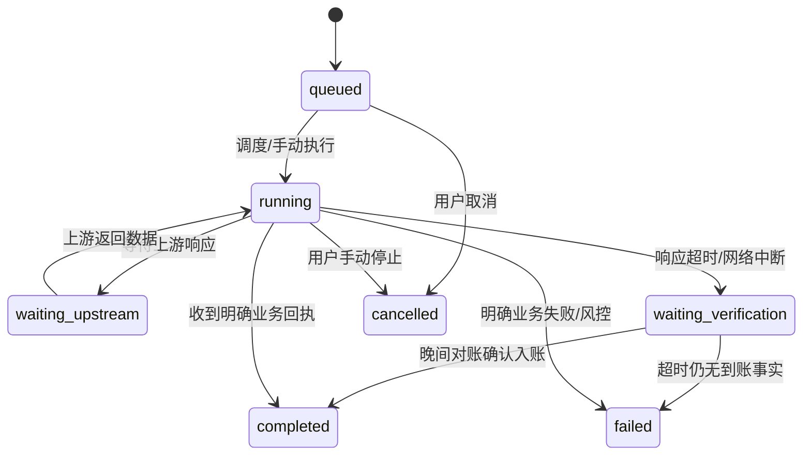

# BuddySwitch 整合项目 W0A「第 0 批三自然日观察方案」（FUS-B0）

> 状态：待批准（第 0 批 FUS-B0 三自然日观察方案；用户批准前不执行任何动作）  
> 撰写日期：2026-10-22  
> 需求来源：`D:\desktop\FUSION-INTEGRATION-v1.1.md`（只读，仓外）  
> 仓内基线：`docs/evidence/2026-10-22-w00-baseline.md`  
> 撰写时工作区 HEAD：`150d1b9709a9a223cd0e7dcd2309b2e8965e34a0`（W00: 回填冻结基线终算哈希；W00 冻结基线提交 = `17c3098`）  
> 交付物关系：本方案为工作包 FUS-W0A（PRD §11）核心交付物之一：**本方案（待批准）→ 经用户签署批准后执行 → 产出 3 自然日观察记录与指标表**。  
> **特别声明：本文档本身为方案设计与执行规范，不触发、不代表已执行任何动作；所有观察、查询、签到、领取、工具循环与开关演练动作必须在文末经用户勾选签署批准后方可按步骤开展。**

---

## 1. 范围与前提

### 1.1 观察对象（第 0 批交付包 FUS-B0）

本方案针对 BuddySwitch 整合项目 PRD v1.1 §4.0 明确定义的「第 0 批先行包」（FUS-B0），聚焦于已在工作树中完成离线代码实现与单元测试回归的三项最小修复，外加两项环境与开关安全护栏：

1. **FUS-R00a（Qoder CN 每日奖励稳定到账）**：
   - 领取接口采用最小请求头形态（minimal 四头：`Authorization`、`Cosy-ClientType`、`User-Agent: Qoder`、`Content-Type`）与空 body；
   - 页面活动列表无积分类活动时，补查一次最小头列表并按活动 ID 状态优先合并；
   - 409 响应必须具备确切业务依据（如服务端明确提示已领）方可判为 `already_claimed`，禁止将未知 409 盲目合成成功；
   - 过期活动在当轮重新查询一次，且仅领取同 campaign key 下新发现的可领活动 ID；不内置过期 ID，严禁盲发。
2. **FUS-R00b（WorkBuddy CN 每日签到稳定成功）**：
   - HTTP 传输层状态严格保留，禁止上游网络或 HTTP 错误被响应体中的 `code=0` 静默覆盖；
   - 固定桌面客户端 User-Agent（默认 `WorkBuddy/5.5.6`）与设备指纹头，防范 10085 网关拦截；
   - 同区域多域名回退（主备域名容灾）；
   - 宽松状态解析，兼容已签到场景，消除虚假报错。
3. **FUS-R00c（dfmodel 工具调用稳定性）**：
   - Qoder DSML 与文本工具调用泄漏恢复（`tool_recover`，仅在声明工具时启用，流式与聚合全路径覆盖）；
   - 结构化工具历史（`qoder-*:dfmodel`、`qoder-*:dmodel`）两区一致生效，杜绝工具调用被作为正文输出进入聊天上下文；
   - 回退开关 `QD_STRUCTURED_TOOL_HISTORY=off` 验证（off 仅回退文本工具历史，不关闭泄漏恢复本身）。
4. **WorkBuddy Global 开关拆分与安全隔离（PRD §17 D4）**：
   - 区分 `BUDDY_SWITCH_WB_GLOBAL_CHECKIN`（仅控制 Global 每日签到接口，默认开）与建议新增的 `BUDDY_SWITCH_WB_GLOBAL_ACTIVE_TASK`（网页/ACP 活跃任务，默认关）；
   - 在 D4 未拍板前，严禁执行任何产生实际模型调用、消耗积分的 Global 网页/ACP 活跃任务。
5. **预览运行与客户端目录安全隔离（PRD §13.2、W00 台账）**：
   - 环境变量 `BUDDY_SWITCH_PREVIEW_LINK_CLIENT_DIRS` 默认保持关闭（`0` / `false` / 未设置）；
   - 预览实例严禁创建外部客户端目录（`~/.qoder-cn`、`~/.qoder`、`~/.workbuddy`、`~/.workbuddy-ai`）的符号联接，确保测试运行绝不污染或改写用户生产环境的客户端登录态。

### 1.2 执行约束与前置条件

1. **批准前零执行原则**：本文档仅供评审与批准。在用户于文末第 9 节完成书面签署并回填账号范围及起始日期之前，不发起任何真实网络请求，不运行任何写操作。
2. **观察期周期定义**：观察期严格限定为 **3 个连续自然日**（以本地自然日 00:00–24:00 计，分别记为 D1、D2、D3），起始日期 D1 由用户在批准栏明确填写。
3. **单一手动触发入口**：
   - 所有观察动作均通过 BuddySwitch 独立预览版图形界面（GUI）或显式 CLI 命令手动触发；
   - **完全禁用后台自动化**：严禁在观察期内启用任何应用内自动调度器任务、Windows 计划任务或后台定时轮询（PRD §7.2），避免静默请求干扰观察口径。
4. **独立数据根与端口隔离**：
   - 预览实例必须显式配置环境变量 `BUDDY_SWITCH_HOME`，指向**已存在的独立绝对目录**（默认推荐 `~/.buddy-qoder-switch-preview`）；
   - 严禁将 `BUDDY_SWITCH_HOME` 指向真实用户 HOME 根目录或生产数据目录 `~/.buddy-switch`（受 `crates/buddy-switch-core/src/modules/config.rs` 启动护栏强制约束）；
   - 预览实例监听端口与现有生产实例错开，Server 默认使用 `57890`（`BUDDY_SWITCH_PORT=57890`），网关如有需要使用错开端口（如 `57893`），严禁占用生产网关端口。
5. **运行中实例零触碰**：
   - 严禁读写、修改当前系统中可能正在运行的 TraeWorkAssistant 或旧版 BuddySwitch 实例的数据文件；
   - 严禁终止（kill）现有正在运行的外部进程；
   - 严格避免与旧应用并发运行相同账号的写操作，防止竞争刷新令牌（Refresh Token）导致生产凭据失效（PRD §7.1.7、§14）。

---

## 2. 账号范围（PRD §17 D3 未拍板）

依据 PRD v1.1 §17 决策项 D3，实际纳管的账号数量尚待用户最终拍板确认。为保证观察计划的严谨性与安全性，本方案提供占位范围表，由用户在审批时填入具体数量。

### 2.1 账号占位与用途定义表

| 平台 | 区域（Region） | 作用域（Scope） | 账号数量（待用户填写） | 本次观察中的具体用途 |
| :--- | :--- | :--- | :--- | :--- |
| **Qoder** | 国内区（CN） | `qoder-cn` | **3 个**（2026-10-22 自真实库 `~/.buddy-switch/qoder/accounts.cn.json` 导入预览库；来源 desktop-app×2、oauth×1，均含有效期令牌） | 验证 FUS-R00a（每日登录奖励领取、回执获取、余额对账）、参与 FUS-M01 统计；作为客户端发起 dfmodel 工具循环验证 FUS-R00c / FUS-M03。 |
| **Qoder** | 国际区（Global） | `qoder-global` | **3 个**（同上导入；仅 W05 对照与 M03 两区一致性时使用） | 仅用于验证 FUS-R00c / FUS-M03 dfmodel 工具调用循环（两区一致性验证）；执行 W05 只读活动列表查询（不参与 M01–M03 奖励统计）。 |
| **WorkBuddy** | 国内区（CN） | `wb-cn` | **3 个**（2026-10-22 自真实库 `~/.buddy-switch/accounts.json` 导入预览库；域均为 codebuddy.cn） | 验证 FUS-R00b（每日签到接口、桌面 UA/指纹头、域名回退机制）；参与 FUS-M02 统计。 |
| **WorkBuddy** | 国际区（Global） | `wb-global` | 4 个（已导入，**保持关闭不执行**） | **默认不执行任何活跃任务**；依据 PRD §17 D4，在活跃任务未拍板前保持关闭，仅作为只读账号信息占位。 |

### 2.2 度量分母口径规则（死锁约定）

为杜绝因统计口径模糊而导致的“指标虚高”或“假失败”，本文档将三个结果指标的分母与分子判定严格死锁如下：

- **FUS-M01（Qoder CN 每日奖励到账率）分母口径**：
  - **分母**：当日**确实存在可领活动**的账号×日（账号日）；
  - **排除项（不入分母）**：若上游服务端在当日未开放任何活动、或接口返回活动列表为空，该账号日单列为「外部条件不可用」，**不计入分母**；
  - **分子**：获得服务端确切领取成功回执（`receipt`）或通过余额对账证明实际到账的账号日；
  - **未决状态**：处于 `pending`（待确认）状态的请求，**绝对不计入分子**。
- **FUS-M02（WorkBuddy CN 每日签到成功率）分母口径**：
  - **分母**：所有在本地持有**凭据有效**（凭据未过期、未处于已知 401 状态）的账号日；
  - **分子**：签到接口返回成功、或返回业务依据明确判定为「此前已签到」（`already_claimed`）的账号日；
  - **异常处理**：若遇到 HTTP 401 或登录凭据失效，该账号日单列记录，并在界面/日志中给出明确的重新登录入口，不计入成功。
- **FUS-M03（dfmodel 连续工具调用完成率）口径**：
  - 详见第 5.3 节分组模型规则；因上游 429 导致的中止归类为「上游阻塞」，不计入失败也不计入通过。

### 2.3 隐私脱敏与身份隔离规则

1. **零敏感信息入库**：文档、日志、实施记录及归档证据中，**严禁出现任何真实凭据、访问令牌（Access Token）、刷新令牌（Refresh Token）、Cookie、完整邮箱、明文手机号或完整 UID**。
2. **掩码规则**：所有涉及账号标识之处，一律使用脱敏 ID，格式固定为平台前缀 + 尾号掩码，例如 `qoder-cn:…ab12cd`、`wb-cn:…ef8901`。
3. **跨区域身份隔离**：严格遵循仓内冻结词汇表 `docs/specs/VOCABULARY.md`，平台不同或区域不同的相同 UID 属于不同的作用域（Scope），**绝对不自动视为同一账号**，禁止跨域串号或凭据混用。

---

## 3. 逐日执行时间线

为确保 3 自然日观察数据的可比性与规律性，建议每日设定固定的执行窗口：上午主执行、晚间复核对账。所有操作均由人工操作预览版界面触发。

### 3.1 每日固定时点安排

- **主执行时段**：本地时间 **09:30 ± 30min**（避开午夜流量与任务拥堵高峰，模拟常规办公使用）。
- **晚间复核时段**：本地时间 **21:00 ± 60min**（核对当日入账、复查待确认项、固化证据快照）。

### 3.2 D1–D3 执行动作矩阵表

| 自然日 | 时点 | 对应任务与动作 | 预期输入与界面入口 | 记录责任与归档要求 |
| :--- | :--- | :--- | :--- | :--- |
| **D1** | 09:30 主执行 | 1. WorkBuddy CN 签到（R00b）<br>2. Qoder CN 每日奖励（R00a）<br>3. dfmodel 工具调用循环（R00c） | 预览版 UI「账号」页或既有签到入口；确认网络连通；模型网关切至独立端口。 | 记录逐账号 HTTP 状态、业务响应码；记录工具循环步数；截图或导出原始帧脱敏存入暂存区。 |
| **D1** | 21:00 复核 | 1. Qoder CN 余额对账（M01 到账依据）<br>2. pending 转态复查<br>3. 401 凭据巡检 | 预览版 UI「用量/积分」查看最新官方余额快照；核对入账差额；检查是否有待确认项。 | 补全 D1 逐账号记录表；核定 D1 分子分母；归档 D1 证据文件至 `docs/evidence/`。 |
| **D2** | 09:30 主执行 | 1. WorkBuddy CN 签到（R00b）<br>2. Qoder CN 每日奖励（正常 minimal 头，R00a）<br>3. **回退开关演练 A21 / A23**（见第 6 节） | 界面手动触发；演练项按第 6 节步骤串行切换环境变量并重启预览实例后触发。 | 演练前后对比记录；精确记录开关值切换、请求头变更及响应结果；单列演练记录行。 |
| **D2** | 21:00 复核 | 1. 余额对账与入账复查<br>2. 回退演练恢复状态确认（确认环境变量均已恢复默认）<br>3. pending 项收敛确认 | 用量页核实 D2 积分变动；检查是否有残留的异常环境变量配置；检查日志无泄漏。 | 补全 D2 逐账号记录表；汇总 A21/A23 演练结果；归档 D2 证据文件。 |
| **D3** | 09:30 主执行 | 1. WorkBuddy CN 签到（R00b）<br>2. Qoder CN 每日奖励（R00a）<br>3. dfmodel 工具调用循环（R00c）<br>*(若 D2 演练因上游无活动顺延，在此补演)* | 恢复全默认开关配置下的标准流程；若 D2 顺延则在此按方案执行补演。 | 记录最终日主执行状态；如发生顺延演练需显著标注原因与环境；记录完整工具时序。 |
| **D3** | 21:00 复核 | 1. 终期余额对账与三日汇总<br>2. 连续 3 日 FUS-M01–M03 最终算力汇总<br>3. 证据集终审 | 全量提取 D1–D3 执行表；核实三日指标是否达成 PRD §1.1 阈值（≥95% / ≥19步）。 | 输出 W0A 3 自然日最终总结报告草案；锁定证据文件清单；准备提交用户评审。 |

### 3.3 主执行详细动作流

1. **WorkBuddy CN 签到（R00b）**：
   - 入口：预览版「账号列表」或「签到工作台」；
   - 动作：逐账号手动点击“签到”；
   - 抓取：记录底层 HTTP 请求状态码、返回的业务 body 中的 `code`、`message`；确认是否命中域名回退或宽松解析。
2. **Qoder CN 每日奖励领取（R00a）**：
   - 入口：预览版 Qoder 活动卡片或操作按钮；
   - 动作：触发“查询活动列表”，检查返回的活动 ID；触发“领取奖励”；
   - 抓取：记录请求头是否为 minimal 四头；记录服务端回执（`receipt_id` 或活动确认标记）；如遇 409，核对是否包含已领业务提示。
3. **dfmodel 工具调用循环（R00c）**：
   - 入口：在外部主力客户端（如 ZCode / Trae）中配置本地预览网关（独立端口），选用 `qoder-cn:dfmodel` 与 `qoder-global:dfmodel`；
   - 动作：发起包含明确工具调用的长上下文会话任务（目标连续跑满 20 步工具循环）；
   - 抓取：监测下发内容，严格检查正文中是否出现 `[assistant 请求调用工具]` 等泄露标记；记录是否因上游 429 中止。

### 3.4 晚间复核动作流

1. **余额对账（M01 到账事实判定）**：
   - 打开用量与积分页面，比对上午领取前后的积分数值变化；
   - 必须有官方积分增加记录或回执编号，方可将当日奖励结果判定为 `confirmed`。
2. **pending（待确认）状态复查**：
   - 检查上午是否有因网络抖动或超时落入 `waiting_verification` / `pending` 的账号；
   - 仅发起**只读状态查询**，绝对不重新发起写请求（PRD §7.1.5）；查询到账则转为 `confirmed`，仍未确认则保持 `pending`（不计成功）。
3. **凭据健康检查**：
   - 检查各账号是否出现 HTTP 401 或 Refresh Token 失效；
   - 若失效，单列记录为凭据错误，并在表格中标记“需重新登录”。
4. **证据固化与归档**：
   - 将日间采集的脱敏日志、时序截图和响应摘要打包，按第 4.5 节规范命名并归档。

---

## 4. 记录字段表与状态机契约

### 4.1 核心记录字段表（全量台账模型）

每一笔操作均须严格按以下 11 个字段记入实施记录表（对齐 PRD §15）：

| 序号 | 字段名 | 说明与合法取值 |
| :---: | :--- | :--- |
| 1 | **日期** | 观察业务日，格式 `YYYY-MM-DD`（如 `2026-10-23`，对应 D1/D2/D3）。 |
| 2 | **账号（脱敏 ID）** | 尾号掩码形式，严禁明文，如 `qoder-cn:…ab12cd`、`wb-cn:…34ef56`。 |
| 3 | **平台/区域** | 严格遵循词汇表：`qoder-cn`、`qoder-global`、`wb-cn`。 |
| 4 | **动作** | 执行操作枚举：`wb_checkin`、`qoder_claim`、`dfmodel_tool_cycle`、`headers_drill_a21`、`tool_history_drill_a23`。 |
| 5 | **阶段（运行态）** | PRD §7 任务运行态 7 状态之一：`queued` / `running` / `waiting_upstream` / `waiting_verification` / `completed` / `failed` / `cancelled`。 |
| 6 | **HTTP 状态** | 传输层实际状态码，如 `200`、`401`、`409`、`429`、`503`；网络超时记 `TIMEOUT`。 |
| 7 | **业务码** | 响应体中的业务字段，如 `0`、`10605`、`ALREADY_CHECKED_IN`、`RISK_DEPENDENCY_UNAVAILABLE`。 |
| 8 | **对账依据** | 证明操作结果的客观事实：回执单号（脱敏）、积分增量（如 `+10 credits`）、或“余额前后一致无增加”。 |
| 9 | **错误分类** | 固定 6 项枚举：`排队` / `凭据失效` / `活动未开放` / `网络故障` / `待确认` / `其他-需人工确认`。正常成功记 `无`。 |
| 10 | **结果状态** | PRD §7 奖励结果 6 状态之一：`confirmed` / `already_claimed` / `pending` / `failed` / `unsupported` / `skipped`。 |
| 11 | **证据文件名** | 对应归档文件，格式如 `20261023-b0-d1-claim-ab12cd.json`。 |

### 4.2 任务运行态与奖励结果状态机解耦契约

依据 PRD §7 核心契约，**任务运行态（Task State）与奖励结果（Reward Result）必须严格分离**，杜绝“只要任务 completed 就判定成功”的虚假上报：



- **奖励结果 6 状态严格定义**：
  - `confirmed`：**已确认成功**。仅在收到服务端明确发放回执或对账证明余额确实增加时标记；
  - `already_claimed`：**此前已领/已签**。收到服务端合法幂等回执，确认当日额度此前已发放，计入签到成功率分子；
  - `pending`：**待确认**。请求已发出但因上游超时、网关断流未获最终状态。**铁律：`pending` 绝对不计入 M01 / M02 成功分子**；
  - `failed`：**失败**。遇到可确诊的业务报错、风控拦截、参数错误等；
  - `unsupported`：**不适用**。该账号或区域在当前上游不支持该动作；
  - `skipped`：**跳过**。用户配置跳过或未开放活动，不计入统计分母。

### 4.3 判定规则与安全铁律

1. **HTTP 失败不可覆盖律（FUS-A22 核心）**：底层 HTTP 传输失败（如返回 500、502、504 或连接重置）时，即使 response body 碰巧包含 JSON 串 `{"code": 0}`，也**绝对禁止**被覆盖为成功，必须严格判定为 `failed`。
2. **409 语义判定律（FUS-A21 / R00a 核心）**：遭遇 HTTP 409 Conflict 时，必须进一步解析 body 内的业务状态码与文案。只有明确包含“今日已领取”、“无需重复参与”等合法幂等依据时才记为 `already_claimed`；若返回无语义的 409 或未知错误，一律记为 `failed`，并保留原始返回供排查。
3. **写请求禁止重试律**：对于处于 `waiting_verification` / `pending` 状态的奖励领取请求，后续复核仅允许进行只读状态查询（如查询活动列表或拉取余额），**严禁重新提交写请求（Claim POST）**，防止引发上游风控封禁或重复操作。

### 4.4 证据文件命名与归档规范

- **命名格式**：`<日期8位>-b0-d<N>-<动作>-<账号尾号掩码>.<扩展名>`
  - 示例：`20261023-b0-d1-claim-ab12cd.json`
  - 示例：`20261024-b0-d2-drill-a21-ab12cd.md`
  - 示例：`20261023-b0-d1-dfmodel-global-ef34gh.json`
- **归档路径**：
  - 测试过程中的原始报文与 trace 暂存在独立预览数据根目录（`~/.buddy-qoder-switch-preview/trace/`）；
  - 每日晚间复核完成后，将剔除所有敏感 Token 的脱敏证据文件同步归档至目标仓库的 `docs/evidence/` 目录下。

---

## 5. M01–M03 计算方式与度量示例

所有计算规则均严格对齐 PRD v1.1 §1.1 结果指标。**本节所有表格内的数据均为虚构数字，仅用于演示计算逻辑，特此显著标注「示例」；真实数字以 3 自然日观察期内的实际记录为准。**

### 5.1 FUS-M01 Qoder CN 每日奖励到账率

- **指标目标**：连续 3 个自然日，按「账号 × 日」计算，到账率 **≥ 95%**。
- **计算公式**：
  $$\text{FUS-M01 到账率} = \frac{\sum(\text{confirmed})}{\sum(\text{当日存在可领活动的有效账号日})} \times 100\%$$
- **逐条统计口径**：
  - **分子**：有服务端明确回执、或经晚间余额核对确认实际增加积分的账号日；
  - **分母**：当日确实开放了可领活动的账号日；
  - **排除项**：
    - 若某自然日上游未下发任何可领活动（列表全空），该日对应账号记为“活动未开放”，**不计入分母**，作为外部不可抗力单列；
    - `pending` 项**不计入分子**；
    - 409（明确已领）视同已完成额度占用，但若当日首次执行即为已领，需核实是否为跨平台已领；
    - 活动过期或未开放分别按错误分类单列。

#### 示例计算表（虚构数字，仅供逻辑推演）

> [!NOTE] 示例声明  
> 下表为虚构推演数据，仅用于展示分母剔除与分子核算逻辑，非真实结果。

| 观察日（示例） | 纳管账号数（示例） | 活动开放账号日（分母） | 到账确认（confirmed，分子） | 此前已领（already_claimed） | 待确认（pending） | 上游无活动（单列剔除） | 当日到账率（示例） | 达标判定（≥95%） |
| :---: | :---: | :---: | :---: | :---: | :---: | :---: | :---: | :---: |
| **D1（示例）** | 20 | 20 | 19 | 1 | 0 | 0 | 100.0% (20/20) | 达标 |
| **D2（示例）** | 20 | 20 | 19 | 0 | 1 | 0 | 95.0% (19/20) | 达标 |
| **D3（示例）** | 20 | 18 | 18 | 0 | 0 | 2 账号活动下线 | 100.0% (18/18) | 达标 |
| **3日汇总（示例）** | **60 账号日** | **58 账号日** | **56** | **1** | **1** | **2 账号日** | **98.28%** (57/58) | **达标** |

### 5.2 FUS-M02 WorkBuddy CN 每日签到成功率

- **指标目标**：连续 3 个自然日，签到成功率 **≥ 95%**。
- **计算公式**：
  $$\text{FUS-M02 成功率} = \frac{\sum(\text{confirmed}) + \sum(\text{already\_claimed})}{\sum(\text{凭据有效账号日})} \times 100\%$$
- **逐条统计口径**：
  - **分子**：签到接口返回成功（`confirmed`）与明确判定为此前已签（`already_claimed`）的账号日之和；
  - **分母**：所有在本地持有有效登录凭据的账号日；
  - **异常与单列**：
    - 遭遇 HTTP 401（凭据失效）的账号日，**计入分母但分子为 0**，并在结果中单列，生成重新登录提示；
    - 同区域主备域名回退（如主域名超时自动切备用域名成功）属于系统自愈，计入成功分子，但在日志与报告中单列回退触发事件（支持 mock 验证）。

#### 示例计算表（虚构数字，仅供逻辑推演）

> [!NOTE] 示例声明  
> 下表为虚构推演数据，仅用于展示签到成功率计算逻辑，非真实结果。

| 观察日（示例） | 凭据有效账号（分母） | 签到成功（confirmed） | 此前已签（already_claimed） | 凭据失效（401，失败） | 域名回退触发（次） | 当日成功率（示例） | 达标判定（≥95%） |
| :---: | :---: | :---: | :---: | :---: | :---: | :---: | :---: |
| **D1（示例）** | 20 | 18 | 2 | 0 | 1（自动回退成功） | 100.0% (20/20) | 达标 |
| **D2（示例）** | 20 | 19 | 1 | 0 | 0 | 100.0% (20/20) | 达标 |
| **D3（示例）** | 20 | 18 | 1 | 1（需重新登录） | 0 | 95.0% (19/20) | 达标 |
| **3日汇总（示例）** | **60 账号日** | **55** | **4** | **1** | **1 次** | **98.33%** (59/60) | **达标** |

### 5.3 FUS-M03 dfmodel 连续工具调用完成率

- **指标目标**：覆盖的模型与区域在 20 步工具循环中，**各达到 ≥ 19/20 步**无正文泄漏、无异常中断。
- **分组模型与绑定规则**：
  - 以 PRD v1.1 §12.1 FUS-A01 规定的 **20 步工具循环**为 1 组；
  - 每一组必须强绑定：`模型 × 作用域 × 日期`；
  - 3 日观察期间，每日必须至少覆盖 2 组测试：
    1. 组 A：`qoder-cn:dfmodel` × 当日日期；
    2. 组 B：`qoder-global:dfmodel` × 当日日期；
    - 其余开放模型（如 `qoder-cn:dmodel`）每日进行 1 轮冒烟。
- **「上游阻塞」与成败判定细则**：
  - **通过**：该组 20 步工具调用全部连续完成，或达到 ≥ 19 步且无任何泄漏标记进入正文、参数与响应回传完全正常；
  - **失败**：正文中出现任何 `[assistant 请求调用工具]` 等 DSML 泄漏文本、或发生非上游原因导致的提前 `end_turn` / 进程崩溃 / 断流，该组直接判定为**失败**；
  - **上游阻塞（单列不计）**：若在执行过程中遇到上游 HTTP 200 内嵌 429、或直接 HTTP 429 `rate_limit_error` / 排队满错误导致循环中止：
    - 该组立即标记为「**上游阻塞（Upstream Blocked）**」；
    - **铁律**：该组**不计入通过，也绝对不计入失败**；
    - 记录表必须如实记录中止时已完成的步数、以及上游返回的 `Retry-After` 秒数，作为外部环境受限的客观证据。

#### 示例计算表（虚构数字，仅供逻辑推演）

> [!NOTE] 示例声明  
> 下表为虚构推演数据，仅用于展示工具调用分组评定规则，非真实结果。

| 观察日（示例） | 绑定组（模型 × 区域） | 计划步数 | 实际完成步数 | 正文泄漏标记 | 终态原因 | 组判定结果（示例） | 达标判定（≥19/20） |
| :---: | :--- | :---: | :---: | :---: | :--- | :---: | :---: |
| **D1（示例）** | `qoder-cn:dfmodel` | 20 | 20 | 无（零泄漏） | 正常完成 | 通过 | 达标 (20/20) |
| **D1（示例）** | `qoder-global:dfmodel` | 20 | 20 | 无（零泄漏） | 正常完成 | 通过 | 达标 (20/20) |
| **D2（示例）** | `qoder-cn:dfmodel` | 20 | 20 | 无（零泄漏） | 正常完成 | 通过 | 达标 (20/20) |
| **D2（示例）** | `qoder-global:dfmodel` | 20 | 8 | 无 | 上游 429 (Retry-After: 60s) | **上游阻塞**（不计） | 外部阻塞（不计入分母） |
| **D3（示例）** | `qoder-cn:dfmodel` | 20 | 20 | 无（零泄漏） | 正常完成 | 通过 | 达标 (20/20) |
| **D3（示例）** | `qoder-global:dfmodel` | 20 | 19 | 无（零泄漏） | 正常完成 | 通过 | 达标 (19/20) |

---

## 6. 回退开关演练项（D2 执行）

依据 PRD v1.1 §12.1（FUS-A21、FUS-A23），回退开关的有效性是第 0 批交付的重要安全网。两项演练**统一安排在第 2 个自然日（D2）的主执行时段之后串行展开**；若 D2 遇到外部阻碍，允许顺延至 D3，严禁伪造演练结果。

### 6.1 FUS-A21：Qoder Claim 请求头回退演练

- **开关定义**：`BUDDY_SWITCH_QODER_CLAIM_HEADERS`（代码位置：`crates/buddy-switch-core/src/modules/qoder/campaign.rs:709`；默认值：`minimal`，且**仅对 CN 区域生效**）。
- **前置条件**：当日所选参与演练的 Qoder CN 账号在列表中确有未领取的积分类活动；全过程**仅抽取 1 个账号执行 1 次领取**。
- **演练步骤**：
  1. 记录初始状态：确认默认未设置该变量（按 `minimal` 四头生效）；
  2. 环境变量切换：在独立预览实例启动环境设置 `BUDDY_SWITCH_QODER_CLAIM_HEADERS=desktop`；
  3. 重启并触发：重启预览实例后，经 GUI 界面手动对该账号触发 1 次活动领取；
  4. 抓包/日志核验：检查底层发出的 HTTP 请求头，确认是否成功回退为携带完整桌面指纹的请求头；记录 HTTP 状态码、业务返回码及回执；
  5. 状态恢复：关闭环境变量设置，恢复默认的 `minimal`，重启实例并记录恢复确认。
- **通过判定标准**：
  - 请求成功完成，收到合法回执，或对账证明积分正常增加；
  - **无风控拦截**：绝不能出现 HTTP 503 `RISK_DEPENDENCY_UNAVAILABLE`、或任何提示账号异常、安全拦截的文案；
  - **顺延处理**：若 D2 当日该账号无任何可领活动，演练顺延至 D3；并在记录表中显著记录顺延原因，**绝对不得伪造请求**。

### 6.2 FUS-A23：结构化工具历史回退演练

- **开关定义**：`QD_STRUCTURED_TOOL_HISTORY`（代码位置：`crates/buddy-switch-core/src/modules/qoder/api.rs:556`；默认值：`auto`，两区一致启用结构化工具历史）。
- **核心契约**：PRD v1.1 附录 A 明确规定——`off` 仅将发往上游的历史消息回退为纯文本工具历史，**绝不会关闭 DSML / 文本泄漏恢复（`tool_recover`）本身**。
- **演练步骤**：
  1. 环境变量切换：在独立预览实例启动环境设置 `QD_STRUCTURED_TOOL_HISTORY=off`；
  2. 重启网关：重启预览实例的异步网关；
  3. 客户端验证：在外部主力客户端（如 ZCode）中接入该网关，针对 `qoder-cn:dfmodel` 发起原截断场景的完整测试任务（至少跑满 1 轮 20 步工具循环）；
  4. 双重断言验证：
     - 断言 (a)：上游请求 payload 中的历史上下文回退为文本工具历史；
     - 断言 (b)：网关转换层的 `tool_recover` 引擎仍然生效，下游客户端收到的响应流中**零泄漏标记**（正文无 `[assistant 请求调用工具]`）；
  5. 状态恢复：撤销该环境变量设置，恢复默认值 `auto`，并记录恢复确认。
- **通过判定标准**：
  - 循环不发生非预期提前 `end_turn`，无崩溃，泄漏恢复引擎精准拦截并规整工具调用；
  - **进程级隔离硬约束**：因涉及进程级环境变量切换，**全过程必须严格串行**，只在独立预览实例中进行，严禁触碰生产环境。

### 6.3 演练记录成行规范

在逐日执行台账中，上述两项演练必须作为**独立记录行**单列，显著标注开关演练属性、切换前后的值、以及验证结论证据文件。

---

## 7. 中止与升级条件

观察期内涉及真实账号交互。为防范不可逆的账号风险或风控封禁，一旦触发以下任一条件，必须**立即中止当日剩余全部写操作**，保留现场证据，并在当日向用户升级汇报。

### 7.1 熔断与立即中止条件

1. **遭遇风控类严重错误**：
   - 任何接口返回 HTTP 503 且内嵌 `RISK_DEPENDENCY_UNAVAILABLE`；
   - 响应中出现包含“风控”、“安全拦截”、“账号异常”、“设备限制”等任何封禁提示文案。
2. **批量 401 凭据失效**：
   - 同一平台、同一区域内，超过 **2 个账号（或超过纳管账号总数的 20%）** 集中出现 HTTP 401 / 凭据失效；
   - 必须立即停止该区域内所有账号的签到与领取动作，防止因网关协议失配导致全量账号被注销。
3. **触及盲发阻断场景**：
   - 当遇到活动列表中无条目、但官方客户端显示有可领活动时，**严禁盲发历史活动 ID**（PRD §17 D5 默认不允许）；
   - 该场景直接记录为“列表无可领但官方可领”，保留证据提交 D5 复议，禁止继续猜测请求。
4. **非预期严重异常**：
   - 发生扣减积分、未声明的第三方写操作、或客户端会话被意外改写等异常行为。

### 7.2 中止后处置规则

- **写动作绝对冻结**：熔断触发后，当日剩余账号的未执行写操作全部置为 `cancelled`；
- **pending 绝不二次提交**：对于已发出请求但状态未决的账号，仅允许执行只读对账查询，**绝不重试写请求**；
- **证据锁定**：完整导出当前进程的日志与网络请求快照，写入 `docs/evidence/` 并标注中止原因；
- **用户决策**：将中断详情、受影响账号脱敏清单及复原建议汇总汇报给用户，由用户决定后续处置。

---

## 8. W05 只读查询计划（独立批次）

依据 PRD v1.1 §11（工作包 W05）及 §0 修订说明，奖励核实链路已与推理链路完全解耦。W05 的目标是核实 Qoder Global 当前的真实活动与领取协议，产出区域能力矩阵与请求头形态结论。

### 8.1 频次上限与操作约束

1. **活动列表只读查询上限**：
   - 每日针对 Qoder Global 发起的活动列表只读查询 **≤ 2 次/日**，避免过度扫描引发供应商频控。
2. **请求头对照单次限制**：
   - 「最小头（minimal） vs 原生身份头（desktop）」对照实验，**仅在列表明确存在可领活动时各执行 1 次 claim**；
   - **事前逐项批准原则**：在发起对照前，必须将候选活动 ID、活动名称清单呈交用户，由用户**逐项勾选确认后**方可执行。
3. **与观察口径物理隔离**：
   - W05 属于协议探测与验证工作，**其所有查询与领取记录均单列建档，绝对不计入 FUS-M01–M03 的分子与分母**；
   - 建议将 W05 安排在 3 自然日观察期之前或之后执行；若在观察期同日执行，台账中必须强行标注 `[W05]` 标签予以隔离。

### 8.2 区域能力矩阵空白模板与填写说明

本模板供 W05 正式执行后回填实测结论，目前保持规范定义：

| 平台与区域 | 活动列表可用性 | claim 请求头形态建议 | 已领幂等性（409 语义） | 过期活动语义 | 到账证据依据 | 归档证据文件名 |
| :--- | :--- | :--- | :--- | :--- | :--- | :--- |
| **Qoder CN** | *已验证（列表可读，支持补查）* | *minimal 四头稳定* | *409 具备已领业务提示* | *单轮重查新 ID* | *官方余额增加 / 服务端 receipt* | `docs/evidence/2026-10-22-w00-baseline.md` |
| **Qoder Global** | 待 W05 实测填报 | 待 W05 对照填报（minimal vs 原生身份头） | 待 W05 实测填报 | 待 W05 实测填报 | 待 W05 实测填报 | 待填 |
| **WorkBuddy CN** | *已验证（支持同区域名回退）* | *桌面 UA + 设备指纹头* | *宽松解析，兼容已签到* | *不适用* | *签到成功回执 / 积分到账* | `docs/evidence/2026-10-22-w00-baseline.md` |
| **WorkBuddy Global**| 待拍板（默认关闭） | 待 D4 拍板 | 待拍板 | 待拍板 | 待拍板 | 待填（当前未启用） |

- **填写规则说明**：
  - 经真机验证的项，必须填写实测结论并附注证据文件名；
  - 未执行真机验证的项，**一律填写“未验证”或“待填”，严禁根据推论或历史代码假定可用**。

---

## 9. 批准栏

本方案为实施规划文档，未经用户书面批准，不产生任何执行效力。

**用户批准：☑ 同意按本方案执行（2026-10-22 用户会话内批准；账号自当时正在运行的 BuddySwitch 真实库导入，其余决定委托 Harness）**

```text
================================================================================
                           BuddySwitch 整合项目
                 W0A「第 0 批三自然日观察方案」审批确认栏
================================================================================

用户批准选项（二选一）：
  [x] 同意按本方案执行 —— 用户 2026-10-22 批准，并委托 Harness 决定其余事项
  [ ] 修改后执行

--------------------------------------------------------------------------------
回填执行参数（Harness 于 2026-10-22 回填）：

1. 观察期起始日期（D1）：2026 年 10 月 22 日
   （D2=2026-10-23，D3=2026-10-24；连续 3 个自然日）

2. 参与观察的真实账号数量（经真实库导入核实的实际值，见 §2.1）：
   - Qoder 国内区（qoder-cn）账号数量：3 个
   - Qoder 国际区（qoder-global）账号数量：3 个
   - WorkBuddy 国内区（wb-cn）账号数量：3 个
   - WorkBuddy 国际区（wb-global）：4 个（保持关闭，不执行活跃任务）

3. 执行环境与安全护栏确认：
   [x] 已确认 BUDDY_SWITCH_HOME 指向独立预览目录，严禁指向真实生产目录
   [x] 已确认 BUDDY_SWITCH_PREVIEW_LINK_CLIENT_DIRS 保持默认关闭（不联接真实客户端目录）
   [x] 已确认禁用一切后台自动任务与 Windows 计划任务，仅手动逐次触发
   [x] 已确认不触碰任何运行中的生产实例
   [x] 2026-10-22 已清除预览家目录下 4 个 10-21 遗留目录联接（仅删链接点，
       真实客户端目录完好），预览回到默认隔离姿态

--------------------------------------------------------------------------------
Harness 代记录的用户委托与执行口径（2026-10-22）：
  a. M01 分子口径：confirmed 与 already_claimed（有业务依据回执）均计入分子，
     统计时分列两行，合计为 M01 分子。
  b. W01 四项缺失证据并入观察窗口采集（受控重放等随观察执行），不单独开会话。
  c. Mimosa 深度安全审计由 Harness 决定立即后台执行。
  d. 执行入口：按 §1 应为预览版界面手动触发；经用户委托，实际采用 server 宿主
     （独立数据根 + 独立端口）调用与界面完全相同的 core 执行器，逐次手动触发、
     逐次记录 run_id 与结果，不启用应用内调度器/自动任务。
  e. W02 及之后工作包：PRD 进入条件已满足，但开工仍待用户明确确认（范围变更）。

用户签署：用户于 2026-10-22 会话内批准（本栏由 Harness 代签记录）   签署日期：2026-10-22
================================================================================
```
